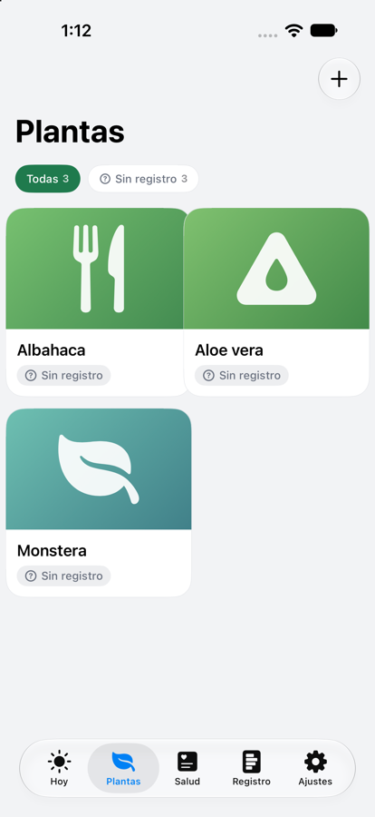
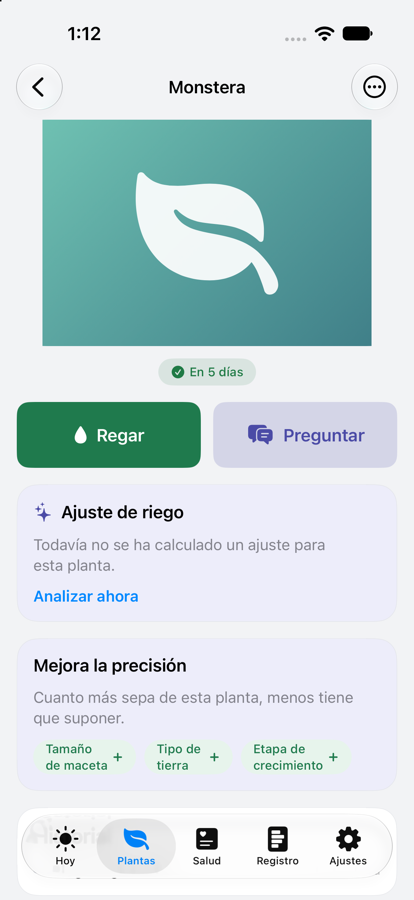
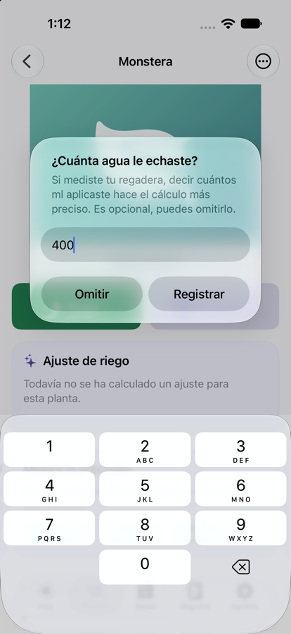
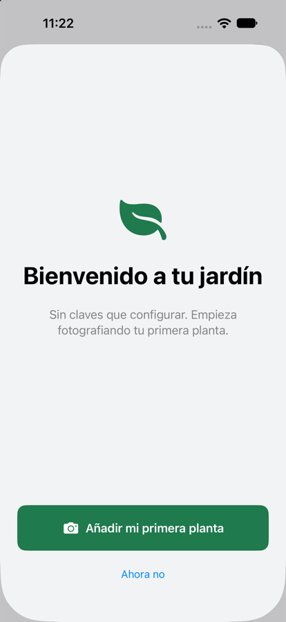
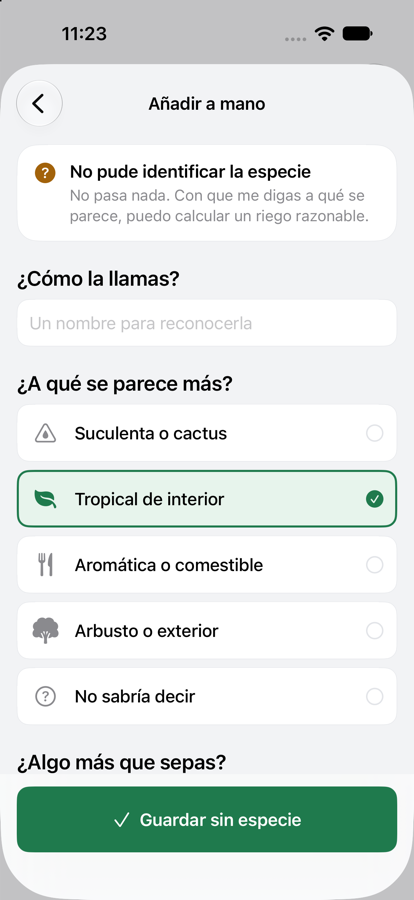
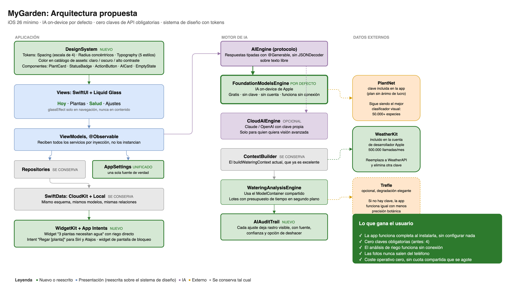
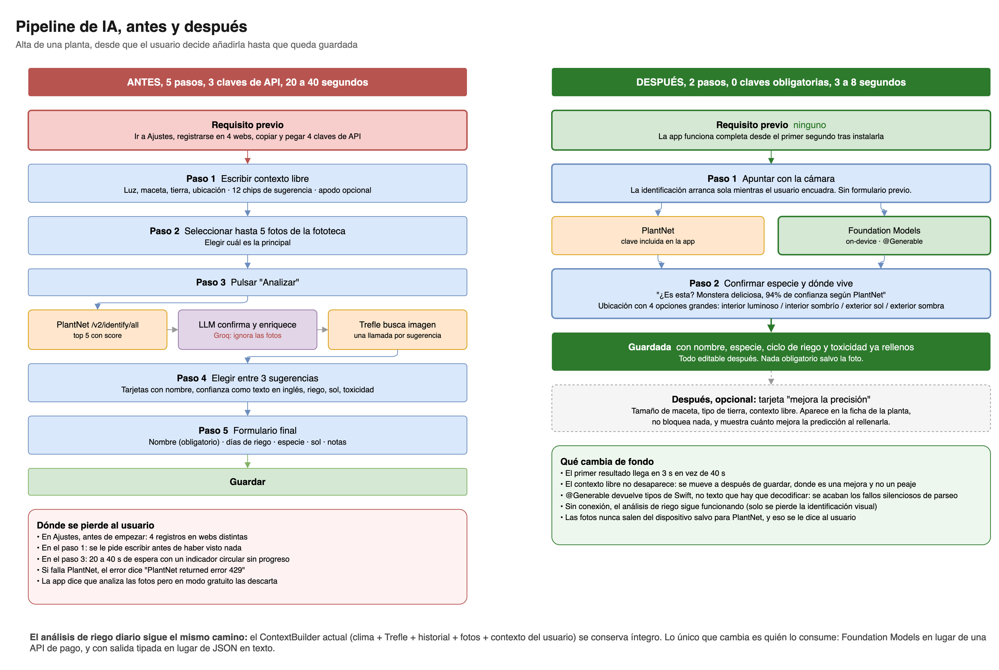

# Jardín (newGardenNew)

App iOS de cuidado de plantas pensada en una sola pregunta: **qué tengo que hacer hoy**. Calcula cuándo regar cada planta con un modelo de balance hídrico propio, y usa IA en el dispositivo solo para explicar y ajustar ese cálculo dentro de límites.

*iOS plant-care app in SwiftUI with SwiftData + CloudKit. Its own watering engine (reference evapotranspiration, crop coefficient, pot geometry and calibration from real waterings), with on-device AI (FoundationModels) that explains and nudges the result within bounds, a home-screen widget with a water button, and Swift Testing.*

| Biblioteca | Detalle de una planta | Registrar un riego |
|---|---|---|
|  |  |  |
| **Bienvenida** | **Añadir sin identificar la especie** | |
|  |  | |

Capturas del simulador con plantas de ejemplo.

## Qué hace

- **Hoy:** la lista de lo que toca regar, con el porqué de cada cálculo.
- **Biblioteca, detalle y salud** de cada planta, con historial de riegos.
- **Añadir planta:** por foto (identificación con PlantNet y datos de Trefle), a mano si no se reconoce, o desde semillas.
- **Widget** en la pantalla de inicio con un botón para marcar el riego sin abrir la app (WidgetKit + App Intents).
- **Sin claves obligatorias:** la IA corre en el dispositivo; las APIs externas son opcionales y la app funciona sin ellas.

## Motor de riego

El intervalo de riego sale de un balance hídrico, no de una tabla fija:

- Evapotranspiración de referencia con la fórmula de **Hargreaves**, contrastada con Open-Meteo.
- **Coeficiente de cultivo** por tipo de planta y etapa de crecimiento.
- **Reserva del sustrato** según la geometría de la maceta (volumen, material, drenaje) y la luz.
- **Calibración** con los riegos reales: si riegas antes o después de lo calculado, el modelo se ajusta.
- La **IA** (FoundationModels, en el dispositivo) explica el resultado y puede moverlo dentro de un rango acotado. Cada ajuste queda registrado, y si el equipo no tiene modelo la app funciona igual.

La investigación y la revisión del algoritmo están en [docs/INVESTIGACION_ACADEMICA_RIEGO_MACETAS.md](docs/INVESTIGACION_ACADEMICA_RIEGO_MACETAS.md) y [docs/BASELINE_ALGORITMO_RIEGO.md](docs/BASELINE_ALGORITMO_RIEGO.md).

## Arquitectura

- SwiftUI con `@Observable`, inyección de dependencias en un solo lugar (`AppDependencies`) y 7 repositorios sobre 12 modelos de SwiftData.
- SwiftData sincronizado con CloudKit, compartido con el widget por un App Group.
- Sistema de diseño propio con 11 colores para modo claro y oscuro.
- Swift 6.2 con aislamiento en `MainActor` por defecto.

## Pruebas

37 pruebas con **Swift Testing**, centradas en el motor de riego: calibración, geometría de la maceta, luz, material y casos sin datos. En el simulador de iOS 27 pasan 33; las 4 del repositorio de calibración (SwiftData) fallan en ese simulador y están pendientes.

## De dónde viene

Es la segunda versión. La primera, **myGarden** (marzo de 2026), integraba seis servicios (PlantNet, Trefle, WeatherAPI, Groq, OpenAI y Anthropic) detrás de una fábrica de proveedores, con centro de salud, rachas y notificaciones. Funcionaba, pero tenía problemas serios de experiencia de uso. Antes de reescribirla hice una auditoría técnica y de UX contra las 10 heurísticas de Nielsen y las guías de Apple para iOS 26: [docs/REPORTE_ESTADO_Y_REDISENO.md](docs/REPORTE_ESTADO_Y_REDISENO.md). Esta versión parte de ese análisis.

## Cómo compilar

1. Xcode 26 o superior, iOS 26.2.
2. Copia `newGardenNew/Core/DI/Secrets.swift.example` como `Secrets.swift` en la misma carpeta. Las llaves son opcionales.
3. Elige tu equipo de desarrollo en *Signing & Capabilities* (el repo no trae ninguno) y cambia el App Group y el contenedor de iCloud por los tuyos.

## Estado

App de uso personal, funcional y en pulido (septiembre de 2026). Desarrollada con asistencia de IA; el diseño del producto, del motor de riego y de la arquitectura es mío.

Juan Francisco Domenech Rossello · [justhipo.github.io](https://justhipo.github.io)
