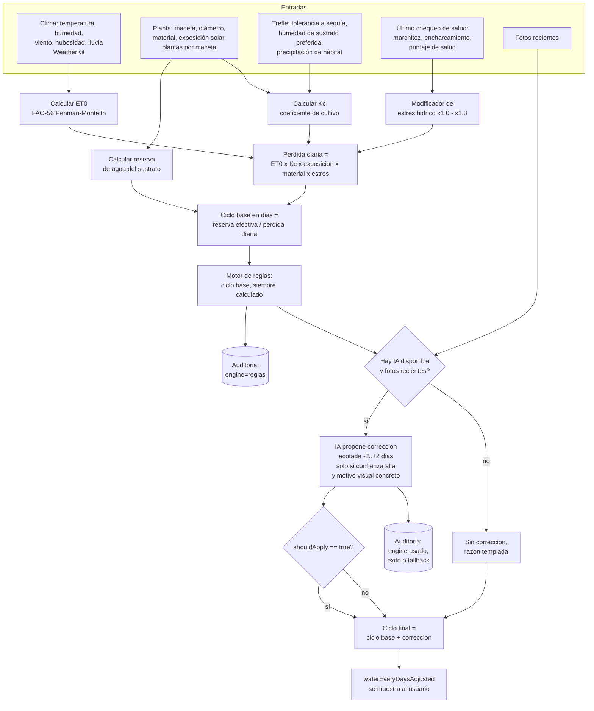

# Análisis del algoritmo de riego (documento para revisión externa)

**Propósito de este documento:** es autocontenido. No hace falta tener el código del
proyecto para leerlo ni para opinar sobre él. Está pensado para que otra persona, con o
sin ayuda de una IA, revise la lógica y el algoritmo de riego de una app de cuidado de
plantas y diga qué haría distinto.

**Fecha:** septiembre de 2026.

---

## 1. El problema

La app recibe una planta (especie si se pudo identificar, tipo de maceta, ubicación,
exposición solar) y tiene que responder una sola pregunta: "cada cuántos días hay que
regarla". El punto de partida de este análisis fue la sospecha, razonable, de que ese
número se sentía arbitrario. Este documento evalúa si esa sospecha está justificada, qué
partes del cálculo son sólidas y cuáles no, y qué se podría mejorar.

---

## 2. Arquitectura actual

El diseño se basa en un principio de gobernanza explícito: **las reglas deterministas
calculan siempre el número, en todos los dispositivos, y un modelo de IA opcional solo
puede corregirlo dentro de un rango acotado y con una razón concreta**. La razón de
fondo es que Apple Intelligence (el motor de IA on-device) no existe en buena parte del
parque de iPhones soportado, así que si la IA fuera la fuente principal del número, la
misma planta con el mismo clima recibiría un consejo distinto según el modelo de
teléfono del usuario. Eso se consideró indefendible y se descartó desde el diseño.



Puntos clave de esta arquitectura:

- El motor de reglas (paso "Motor de reglas" arriba) es una función pura, sin red, sin
  modelo, testeable con asserts simples.
- La IA nunca genera el número desde cero. Solo puede mover el resultado del motor de
  reglas en un rango de -2 a +2 días, y solo si declara confianza alta con un motivo
  concreto (típicamente algo visible en una foto que las reglas no pueden ver: una hoja
  caída, tierra con moho, un tallo blando).
- Cada decisión queda auditada: qué motor respondió, si la corrección de IA se aplicó o
  no, y por qué se cayó a las reglas solas si la IA falló. Esto existe para poder
  explicar después "ese día respondió el motor de reglas solo porque la IA no estaba
  disponible", en vez de que el usuario reciba un número sin trazabilidad.

---

## 3. El algoritmo determinista, en detalle

El modelo es un **balance hídrico**: una reserva de agua que se vacía por
evapotranspiración y se rellena con riego registrado y lluvia real.

### 3.1 Evapotranspiración de referencia (ET0)

Se calcula con la ecuación completa **FAO-56 Penman-Monteith** (no una simplificación
tipo Hargreaves, que solo usa temperatura y sobreestima en climas húmedos porque ignora
humedad, viento y radiación). Necesita:

- Temperatura máxima y mínima del día.
- Humedad relativa.
- Velocidad del viento (asumida a 2 metros de altura, el estándar de referencia cuando
  no se conoce la altura real del sensor).
- Radiación solar, estimada a partir de la nubosidad reportada por el clima (fórmula de
  Angstrom-Prescott, usando la fracción de cielo despejado como sustituto de horas de
  sol reales, que ninguna API de clima usada da directamente).
- Latitud, para calcular la radiación extraterrestre teórica según la época del año.
- Elevación, asumida como nivel del mar (0 metros) porque ninguna fuente de datos de la
  app reporta la elevación real de la planta; es un error de segundo orden comparado con
  otros términos de la ecuación.

El resultado es un número en milímetros de agua evaporada por día sobre una superficie
de referencia (césped bien regado). Es el término mejor fundamentado de todo el modelo:
es literalmente el método estándar internacional (FAO Irrigation and Drainage Paper 56).

### 3.2 Coeficiente de cultivo (Kc)

ET0 es la demanda del clima, no la de la planta. Se ajusta multiplicando por un
coeficiente de cultivo, en cascada según qué dato exista, de más a menos directo:

1. Si Trefle reporta `soil_humidity` (escala de 0 a 10 de preferencia de humedad de
   sustrato en el hábitat natural de la especie): `Kc = 0.4 + (soil_humidity / 10)`.
2. Si no, pero hay rango de precipitación anual del hábitat: se promedia y se escala
   contra 800 mm/año como punto de referencia Kc=1.0.
3. Si no, pero Trefle marca la especie como tolerante a sequía: `Kc = 0.4`.
4. Si no, pero está marcada como vegetal/hortaliza: usa el Kc del grupo funcional o 1.0,
   el que sea mayor.
5. Si no hay ningún dato de especie: usa el Kc del grupo funcional (suculenta, tropical
   de interior, aromática, arbusto de exterior) o, en último caso, 0.7 por defecto.

Además, la etapa de crecimiento actual de la planta (germinación, floración,
fructificación, etc.) multiplica ese Kc, porque una planta en fructificación consume
mucha más agua que una recién germinada de la misma especie.

### 3.3 Modificadores

- **Exposición solar:** sol pleno x1.3, sombra parcial x1.0, luz indirecta x0.85, poca
  luz x0.6.
- **Material de maceta:** terracota x1.25 (porosa, evapora por las paredes), plástico
  x0.9, cerámica/esmaltada x1.0.
- **Estrés de salud visible:** si el último chequeo de salud detectó palabras clave de
  marchitez/sequía en el diagnóstico, x1.3. Si detectó encharcamiento/pudrición, x0.75.
  Si el puntaje de salud es bajo sin motivo claro, x1.15. Si no hay chequeo o no hay
  nada que destaque, x1.0.

### 3.4 Reserva de agua

```
reserva_mm = max(20, diametro_cm x 2.2)
```

Esta es la parte que **ya se corrigió una vez en vivo**: el valor anterior era
`diametro_cm x 4.5`, y sobreestimaba la reserva real al doble, lo que hacía que una
maceta de 20 cm de frijoles (que agronómicamente debería regarse cada 2-3 días) saliera
calculada en 28-36 días. El valor actual (2.2) es una corrección razonada contra
guías hortícolas generales, pero sigue siendo una única constante lineal que no
distingue tipo de sustrato ni forma real de la maceta.

La lluvia (reciente y pronosticada a 3 días) se suma a la reserva, pero solo al 50% de
su valor, para representar que parte de la lluvia escurre y no queda disponible.

Si varias plantas comparten una maceta, la reserva se divide entre ellas por partes
iguales (`reserva / número de plantas`).

### 3.5 La fórmula final

```
perdida_diaria_mm = max(0.1, ET0 x Kc x exposicion x material x estres_salud)
reserva_efectiva_mm = (reserva_mm + lluvia_mm x 0.5) / plantas_en_la_maceta
ciclo_dias = reserva_efectiva_mm / perdida_diaria_mm     (redondeado, entre 1 y 60 días)
```

Es una única división. No hay estado que se acumule día a día: cada vez que se
recalcula, se parte de cero con el clima y los datos de ese momento. Esto es relevante
para la sección 9.7 más abajo.

---

## 4. La capa de IA (correctiva, acotada)

Cuando hay fotos recientes y un motor de IA disponible en el dispositivo (Apple
Intelligence on-device, Private Cloud Compute, o una clave propia como respaldo), se le
envía un contexto estructurado (clima, Trefle, ciclo base calculado, últimas fotos) y se
le pide una corrección. Esa corrección solo se aplica si el modelo declara **confianza
alta** y da un **motivo concreto**. Está limitada a un rango de -2 a +2 días respecto al
ciclo base. Si el modelo no está disponible, falla, o no hay fotos, la app usa el ciclo
base con una explicación con plantilla (sin IA) y lo deja anotado en la auditoría.

---

## 5. Qué es defendible de esta arquitectura

- El marco conceptual (balance hídrico: reserva que se vacía por evapotranspiración y se
  llena con riego/lluvia) es el enfoque agronómico estándar, no una tabla arbitraria de
  "cactus cada 15 días".
- Usar Penman-Monteith completo en vez de una fórmula simplificada es una elección
  técnicamente correcta y poco común en apps de consumo.
- La cascada de señales de Kc (de más a menos directa) es razonable dado lo que
  realmente devuelve una API de datos de plantas como Trefle.
- El principio "las reglas siempre calculan, la IA solo corrige dentro de un rango
  acotado y auditado" es la decisión de diseño más importante y la más defendible: evita
  que el consejo de riego dependa del hardware del usuario, y separa lo calculado de lo
  inferido en el registro.
- Ya hay evidencia de que el equipo corrige errores reales cuando los encuentra (el caso
  del `diametro x 4.5` sobreestimado, el caso del reparto de reserva entre varias
  plantas en una maceta).

---

## 6. Qué es genuinamente arbitrario o débil

1. **La reserva se estima solo por el diámetro de la maceta**, asumiendo que la
   profundidad es proporcional al diámetro. Una maceta baja y ancha y una alta y
   estrecha del mismo diámetro reciben la misma reserva, lo cual es físicamente falso.
2. **La constante de conversión (2.2 mm por cm de diámetro) es una estimación calibrada
   contra un solo caso conocido**, no contra mediciones sistemáticas. Es mejor que la
   anterior, pero sigue siendo una sola cifra global para cualquier tipo de sustrato.
3. **No hay ningún término para el tipo de sustrato** (turba, fibra de coco, mezcla para
   cactus, corteza para orquídeas retienen agua de forma muy distinta). Solo se modela
   el material del recipiente, no lo que hay adentro.
4. **ET0 con Penman-Monteith está pensado para exterior**, con viento y radiación solar
   reales. Aplicado a una planta de interior (viento casi nulo, luz filtrada por
   ventanas), tiende a sobreestimar la pérdida de agua salvo que el modificador de
   exposición ("interior luminoso" x0.85, "interior sombrío" x0.6) compense lo
   suficiente, y esos dos números son heurísticos, no derivados de ninguna medición.
5. **El reparto de reserva entre plantas de una misma maceta es lineal e igualitario**,
   pero las raíces no compiten en partes iguales: la planta con sistema radicular más
   grande se lleva más agua.
6. **El Kc por rango de precipitación del hábitat natural es una proxy indirecta**: la
   lluvia anual de la región de origen de una especie no es lo mismo que su demanda real
   en una maceta con sustrato drenante y sin competencia de otras plantas.
7. **El único punto donde el sistema "mira" el estado real de la tierra es la búsqueda
   de palabras clave en el texto de un chequeo de salud anterior**, y solo si ese
   chequeo existe y es reciente. No hay ninguna medición directa de humedad en ningún
   punto del sistema hoy.

---

## 7. Síntesis de la revisión cruzada (tres modelos de IA distintos)

Se le presentó una descripción neutral del algoritmo (sin mencionar el proyecto ni el
código) a tres modelos de IA distintos (Gemini, una variante rápida de Gemini, y
ChatGPT), pidiéndoles una evaluación de ingeniería/agronomía, no de producto. Las tres
respuestas, de forma independiente, coincidieron en:

- El marco de balance hídrico es el correcto; ninguna propuso reemplazarlo.
- El punto más débil no es el clima, es el tamaño y las propiedades del "recipiente" que
  ese clima está vaciando (la reserva). Los tres señalaron el diámetro como proxy pobre
  del volumen real y la falta de un término de sustrato.
- ETo Penman-Monteith aplicado sin ajuste fuerte a interiores sobreestima la pérdida de
  agua, porque la ecuación asume viento y radiación de exterior.

Un punto de desacuerdo real entre ellas: dos de las tres (las dos Gemini) propusieron
"aprender del comportamiento real de riego del usuario" como la mejora prioritaria.
ChatGPT, en cambio, propuso el peso de la maceta (lisimetría por pesada) como la fuente
de calibración ideal, y advirtió sobre un **problema de identificabilidad**: dos
macetas con exactamente los mismos datos que el modelo observa pueden contener
cantidades de agua reales muy distintas, y ningún algoritmo puede distinguirlas sin
alguna forma de observación directa.

**Nota de honestidad metodológica:** la pregunta que se les hizo a los tres modelos
incluía, en su propia redacción, "aprendizaje a partir de cuándo el usuario riega
realmente" como una de las opciones sugeridas de respuesta. Eso sesga la comparación:
que dos modelos "eligieran" una opción que ya estaba en la lista no es una convergencia
tan fuerte como parece. Lo que sí es una señal más limpia es que ChatGPT, sin que esa
opción específica (peso de la maceta) estuviera en la lista, llegó a ella de forma
independiente.

Un dato de la literatura académica (no de ninguna IA) que vale la pena tener presente:
estudios sobre plantas leñosas en contenedor encontraron que el Kc de una misma especie
puede variar hasta 3.7 veces entre meses del ciclo de cultivo para especies de alto
consumo de agua. Esto confirma, con datos de campo reales, que hay un techo de
incertidumbre en Kc que ningún ajuste de software cierra del todo sin sensado directo
(fuente: *Water Conserving Irrigation Practices, Plant Growth, Seasonal Crop
Coefficients, and Nutrition of Container-Grown Woody Ornamentals*, MDPI Water, 2019).

---

## 8. Techo de precisión teórico

Sin ningún tipo de sensado directo del sustrato, el consenso (de las tres IAs y de la
literatura de viveros comerciales) es que el error esperado de un modelo puramente
climático ronda entre **3 y 5 días** en macetas pequeñas, donde el ciclo completo de
secado puede ser de apenas 4 a 8 días. Eso significa que el error relativo puede llegar
a ser de 50-75% del intervalo real en los casos más chicos, no un margen menor.

La comparación con la "prueba del dedo" es reveladora: el dedo mide directamente y en el
momento el estado real del sustrato (aunque solo en los primeros centímetros), mientras
que el modelo climático es una estimación indirecta acumulada en el tiempo, sin
retroalimentación. Un modelo de lazo abierto (que nunca observa si acertó) no puede, en
principio, superar de forma consistente a una medición directa, por sofisticada que sea
la física del clima detrás.

---

## 9. Investigación externa

### 9.1 Open-Meteo: `et0_fao_evapotranspiration` (explicación técnica)

El servicio meteorológico Open-Meteo (gratuito, sin autenticación, con límites
razonables para uso no comercial) expone un campo llamado `et0_fao_evapotranspiration`
en su API diaria/horaria. Es, literalmente, el mismo ET0 de referencia FAO-56
Penman-Monteith que el motor de reglas de la app calcula manualmente en unas 90 líneas
de Swift (temperatura, humedad, viento, radiación estimada por nubosidad, latitud,
elevación asumida a nivel del mar).

Esto importa por dos razones distintas, que conviene no confundir:

1. **Validación cruzada (cross-check), no reemplazo conceptual.** El código actual ya
   tuvo un bug real y silencioso en una constante relacionada (`reserveDepthPerCm`
   sobreestimando la reserva al doble). Una fórmula física implementada a mano, sin
   ningún test contra un valor de referencia externo, puede tener errores de signo, de
   unidades, o de orden de magnitud que compilan sin problema y producen un número
   plausible pero incorrecto. Comparar el ET0 calculado a mano contra el que devuelve
   Open-Meteo para el mismo lugar y fecha es una forma barata de detectar ese tipo de
   error sin escribir un test unitario para cada término de la ecuación de
   Penman-Monteith.
2. **Reducción de superficie de mantenimiento**, no de rigor. Si algún día se decide
   simplificar el código, ya existe un ET0 correcto y mantenido por terceros que se
   puede consumir directamente, sin perder precisión frente a la implementación propia
   (ambas son la misma ecuación FAO-56).

Ninguna de las dos razones cambia el modelo conceptual del balance hídrico: siguen
haciendo falta la reserva, el Kc y los modificadores propios de la app. Open-Meteo solo
resuelve el término de "demanda atmosférica", que además es, de todo el modelo, el que
ya está mejor fundamentado.

El campo de humedad de suelo del mismo servicio (`soil_moisture_0_to_1cm`, etc., en
capas hasta 81 cm) proviene de un modelo de reanálisis (ERA5-Land), con resolución de
malla de entre 9 y 11 km. Es humedad de suelo natural en el terreno, no de una maceta
con sustrato artificial, así que solo es un proxy razonable para plantas al aire libre
plantadas o en macetas de exterior, y no aplica a nada en interior.

### 9.2 Perenual (segundo voto sobre Kc/ciclo)

Además de Trefle, existe Perenual, otra base de datos de especies con un campo directo
de riego: `watering` (categorías "Frequent"/"Average"/"Minimum"/"None") y
`watering_general_benchmark` (un rango de días concreto, curado por horticultores, por
ejemplo "5-7"). Es útil sobre todo como alarma de sensatez: si el motor calcula un
número muy alejado del que sugiere esta fuente independiente para la misma especie, es
la misma clase de señal que destapó el bug de la maceta de frijoles, antes de que un
usuario lo note en la práctica. El tier gratuito tiene un límite de 100 llamadas por
día; los campos más finos (volumen exacto de agua, horario recomendado, rango de pH)
son de pago.

### 9.3 Capacidad de retención de agua por tipo de sustrato (tabla, no API)

No existe una API pública que reporte la capacidad de retención de agua del sustrato
específico de una maceta doméstica. Sí existe literatura de extensión agrícola
(Virginia Tech, Purdue) con rangos publicados: un sustrato sin suelo (potting mix
típico) debería tener entre 10% y 15% de agua disponible por volumen, con 40-50% de
espacio de aire. Eso permite construir una tabla estática (turba, fibra de coco, mezcla
para cactus, corteza de orquídea, cada uno con su rango de capacidad) y usarla para
escalar el volumen estimado de la maceta, en vez de una única constante lineal por
diámetro. Requiere agregar un campo de "tipo de sustrato" al alta de la planta.

### 9.4 Fracción de lixiviación: la app no responde "cuánta agua", solo "cuándo"

La práctica profesional de viveros no solo programa cuándo regar, también cuánta agua
aplicar, algo que esta app no toca en absoluto hoy. La recomendación estándar es regar
hasta que entre 15% y 20% del agua aplicada drene por el fondo de la maceta,
específicamente para evitar que las sales del fertilizante y del agua de la llave se
acumulen en el sustrato con el tiempo.

La forma correcta de trasladar esto a un usuario doméstico no es pedirle que calcule un
porcentaje: es una señal visual, no una medición. La instrucción práctica es "riega
despacio hasta que veas que empieza a salir agua por los agujeros de abajo de la
maceta, y para poco después de que eso empiece a pasar". Ese chorrito que sale, sin que
nadie lo mida, es aproximadamente ese 15-20% que los viveros sí llevan registrado por
volumen. Es un tip de texto barato de agregar (por ejemplo, recordado una vez al mes,
no en cada riego), y resuelve una pregunta real que hoy la app no contesta.

### 9.5 Sensores baratos: ecosistema ya existente

Sensores capacitivos de bajo costo (Xiaomi Mi Flora / VegTrug, 12-17 euros, batería de
1.5-2 años) ya tienen librerías abiertas maduras para leer sus datos por Bluetooth
(`miflora` en Python, soporte nativo en ESPHome, integraciones documentadas de Home
Assistant). No hace falta construir hardware propio para un piloto: hace falta leer el
protocolo BLE de un sensor de bajo costo que ya existe y está documentado por la
comunidad.

### 9.6 Proyectos comparables encontrados en línea

**Apps comerciales (Planta, Vera):** ninguna publica su algoritmo real. Planta anuncia
"más de 30 parámetros y clima local" en su marketing, pero no hay documentación técnica
pública verificable. No hay una arquitectura de referencia mejor ahí afuera que se esté
dejando pasar; simplemente no publican cómo funcionan.

**Apps de cuidado de plantas open source (Plant-it, myplants-app, Water Me):** las tres
son, en el fondo, recordatorios de intervalo fijo configurado a mano por el usuario, sin
ningún modelo climático ni de balance hídrico. La documentación de Plant-it lo dice
explícitamente: "no recomienda, solo registra actividad". Confirma que la combinación de
balance hídrico + clima real + IA acotada que ya tiene esta app es más sofisticada que
cualquier proyecto de código abierto de cuidado de plantas encontrado.

**OpenSprinkler (riego de jardines/césped, proyecto real y usado por miles de
personas):** ofrece dos métodos de ajuste por clima. El método Zimmerman (más simple,
un porcentaje de riego ajustado por humedad/temperatura/lluvia del día anterior, con
pesos configurables) genera quejas recurrentes de imprecisión en sus propios foros de
usuarios. El método por ET0 (más riguroso, similar en espíritu al de esta app) existe
como alternativa más nueva y menos usada. Esto es evidencia real, no una opinión de IA,
de que los métodos de ajuste "simples" (un porcentaje sobre un valor base) fallan en la
práctica, y que haber empezado directamente con Penman-Monteith completo evitó ese
error común.

### 9.7 El hallazgo más útil: el modelo de "cubeta" (bucket model) de estado acumulado

Dos proyectos activos y reales hacen algo estructuralmente distinto a esta app:
**IrrigationScheduler** (un framework de Python para riego agrícola) y
**HAsmartirrigation** (un componente de Home Assistant para riego de jardines). Ambos
implementan lo que en agronomía se llama un modelo de "cubeta": en vez de calcular
`reserva ÷ pérdida diaria = X días` como una foto fija cada vez que se pide un
recálculo, llevan una **cuenta corriente que se actualiza cada día**:

```
estado_hoy = estado_ayer + lluvia_hoy + riego_hoy - ET_hoy - drenaje_hoy
```

Y cada día comparan ese estado contra un umbral (por ejemplo, "cuando el agotamiento
supere el 40% del agua disponible, hay que regar"), en vez de proyectar hacia adelante
asumiendo que el clima futuro se parecerá al de hoy.

Esto es una diferencia de arquitectura real y concreta frente al motor actual de la
app, que sí recibe clima con pronóstico a 3 días pero calcula el ciclo como una
división puntual en el momento del análisis, sin mantener un estado persistente que se
vaya actualizando con el clima real de cada día transcurrido. Un modelo de cubeta sería
más preciso porque absorbe la variación real día a día (un día inusualmente caluroso
gasta más reserva ese día específico, no se diluye en un promedio) y, como beneficio
adicional, es la estructura natural para incorporar después tanto riegos reales
registrados como una eventual lectura de sensor, sin rediseñar el modelo.

**El dato más interesante de toda esta investigación:** en la propia documentación de
HAsmartirrigation se menciona que un fork del proyecto exploró lo que llaman "dirección
de lazo cerrado", con una función descrita como "crédito de cubeta por riego
observado" (*observed-watering bucket crediting*). Es decir, otro proyecto de código
abierto, resolviendo el mismo problema en la práctica y sin que nadie le sugiriera la
idea, llegó de forma independiente a algo equivalente a "usar el riego real del usuario
para corregir el modelo", la misma propuesta que salió de la revisión cruzada con IA en
la sección 7. Esto es una señal más fuerte que la de esa sección, porque no depende de
lo que se le preguntó a un modelo de lenguaje: es una decisión de diseño real, tomada
por otro equipo, en un proyecto de producción.

---

## 10. Sensores de humedad y electrónica: beneficios y problemas concretos

### Lo que aportarían

- Una medición directa del estado del sustrato, que es exactamente el punto ciego
  identificado en la sección 6 y 7: el tamaño y las propiedades reales del "tanque" que
  el modelo climático intenta vaciar en teoría.
- Servirían para calibrar las constantes del modelo (la reserva por tipo de sustrato,
  el Kc real de una especie en las condiciones concretas de esa casa) en vez de
  depender solo de literatura general o de proxies indirectos de hábitat natural.
- El ecosistema de hardware barato y librerías abiertas ya existe (sección 9.5), así que
  la barrera de entrada para un piloto es baja.

### Los problemas reales, no hipotéticos

- **Deriva de calibración por sales.** Hay investigación publicada mostrando que la
  salinidad del sustrato (por fertilizante o por el agua de riego) puede desviar la
  curva de calibración de un sensor capacitivo barato hasta un 30%, y que requiere
  recalibración periódica y específica para cada sustrato. Un sensor sin mantenimiento
  no es una fuente de verdad estable; con el tiempo puede llegar a mentir tanto como el
  modelo climático que se supone que iba a corregir.
- **Corrosión y degradación física.** Los sensores resistivos baratos se oxidan en
  cuestión de meses en contacto continuo con tierra húmeda. Los capacitivos son mejores
  en este aspecto, pero no están exentos de degradación con el tiempo.
- **Medición puntual, no representativa.** Un sensor mide en el punto exacto donde está
  insertado, a una profundidad fija. La humedad del sustrato no es uniforme: puede haber
  zonas secas cerca de la superficie y húmedas más abajo, o al revés, según cómo drene
  esa maceta en particular. Un solo punto de lectura no captura eso.
- **Costo y logística por planta.** Un sensor por maceta no escala bien a un jardín con
  muchas plantas: hay que comprarlo, emparejarlo, ponerle pilas, y mantenerlo por cada
  una. Tiene sentido como piloto en 2-3 plantas, no como requisito general.
- **Restricciones de Bluetooth en segundo plano en iOS.** Core Bluetooth (el framework
  de Apple para Bluetooth Low Energy) limita fuertemente el escaneo en segundo plano.
  Un monitoreo verdaderamente continuo, sin que el usuario tenga que abrir la app
  seguido, necesitaría un puente intermedio (un hub tipo Home Assistant o un
  Raspberry Pi con ESPHome) que reciba los datos y se los pase a la app, en vez de que
  el iPhone solo lea el sensor directamente cuando quiera.
- **Asimetría entre plantas con y sin sensor.** Si el sensor es opcional, hay que
  decidir cómo se comporta y se audita el sistema cuando una planta lo tiene y otra no,
  el mismo problema que ya se resolvió para "hay IA disponible o no", pero aplicado a
  una fuente de datos nueva.

### Recomendación

Tratar el sensor como una fuente más de datos (igual que el clima o Trefle hoy), nunca
como reemplazo del motor de reglas, y limitarlo a un piloto acotado en pocas plantas
para validar y calibrar el modelo antes de considerar si vale la pena generalizarlo.

---

## 11. Propuestas priorizadas

1. **Calibración por comportamiento real de riego, basada solo en fechas, sin fotos ni
   IA.** Comparar el ciclo predicho contra el día real en que el usuario riega, y
   mantener un único multiplicador por planta que absorba el error acumulado de esa
   maceta concreta (sustrato, forma real, microclima), sin necesidad de saber por qué
   existe ese error. No depende de que ningún modelo entienda una foto.
2. **Migrar de "división puntual" a un modelo de cubeta (estado acumulado día a día)**,
   como hacen IrrigationScheduler y HAsmartirrigation. Es la base natural para
   incorporar después tanto la calibración del punto 1 como una eventual lectura de
   sensor, sin rediseñar el modelo otra vez.
3. **Tabla de capacidad de retención de agua por tipo de sustrato**, en vez de la
   constante lineal por diámetro, usando los rangos publicados por extensión agrícola.
4. **Open-Meteo como validación cruzada del ET0 calculado a mano**, para detectar bugs
   de fórmula como el que ya ocurrió una vez, sin cambiar el modelo conceptual.
5. **Perenual como segunda fuente de Kc/ciclo**, para marcar predicciones que se alejen
   demasiado de lo que dice una fuente independiente, igual que Trefle hoy.
6. **Tip de "riega hasta que drene" de vez en cuando**, para la pregunta de "cuánta
   agua", que hoy la app no contesta en absoluto.
7. **Piloto de sensor barato en pocas plantas**, solo como fuente de calibración y
   validación, con las limitaciones de la sección 10 explícitas desde el diseño.

---

## 12. Preguntas abiertas para quien revise esto

- ¿El modelo de cubeta (estado acumulado día a día) vale el costo de rediseño frente al
  cálculo puntual actual, dado que de todas formas hay un techo de precisión de varios
  días sin sensado directo?
- ¿Vale la pena pedirle al usuario el tipo de sustrato al dar de alta una planta, o es
  fricción de alta que no se traduce en suficiente ganancia de precisión?
- Dado el problema de identificabilidad que señaló una de las tres IAs consultadas
  (sección 7): ¿un solo multiplicador de calibración por planta, aprendido de fechas
  reales, es suficiente para el objetivo real de la app (predecir cuándo, no explicar
  por qué), o hace falta algo más elaborado?
- ¿La corrección visual de la IA (±2 días desde fotos) aporta más de lo que arriesga,
  dado lo poco confiable que es interpretar humedad de sustrato desde una foto de
  teléfono? ¿Vale la pena instrumentar si esa corrección se correlaciona con el
  comportamiento real del usuario antes de decidir si ampliarla, mantenerla o quitarla?
- Si se hiciera un piloto de sensor, ¿qué tan aceptable es depender de un puente externo
  (Home Assistant, Raspberry Pi) para monitoreo continuo, dado que iOS restringe el
  Bluetooth en segundo plano?

---

## Apéndice: constantes y fórmulas exactas del código actual

```
reserveDepthPerCm = 2.2                 // mm de reserva por cm de diámetro de maceta
defaultContainerDiameterCm = 18         // cuando no se conoce el diámetro real
assumedElevationM = 0                   // nivel del mar, siempre

exposureFactor:
  sol pleno            -> 1.3
  sombra parcial        -> 1.0
  luz indirecta         -> 0.85
  poca luz              -> 0.6
  desconocido           -> 1.0

materialFactor:
  terracota / arcilla   -> 1.25
  plastico              -> 0.9
  ceramica / esmaltada  -> 1.0
  desconocido           -> 1.0

healthStressModifier:
  senales de sequia en ultimo chequeo      -> 1.3
  senales de exceso de riego               -> 0.75
  puntaje de salud bajo (<=4) sin motivo   -> 1.15
  sin chequeo o sin senales                -> 1.0

reserva_mm            = max(20, diametro_cm x reserveDepthPerCm)
lluvia_util_mm         = (lluvia_reciente_mm + lluvia_pronosticada_3dias_mm) x 0.5
reserva_efectiva_mm    = (reserva_mm + lluvia_util_mm) / plantas_en_la_maceta

perdida_diaria_mm      = max(0.1, ET0 x Kc x exposicion x material x estres_salud)

ciclo_dias             = round(reserva_efectiva_mm / perdida_diaria_mm)
ciclo_dias             = clamp(ciclo_dias, minimo=1, maximo=60)

correccion_IA          = aplicada solo si shouldApply == true, rango [-2, +2] dias
ciclo_final            = clamp(ciclo_dias + correccion_IA, minimo=1, maximo=60)
```
