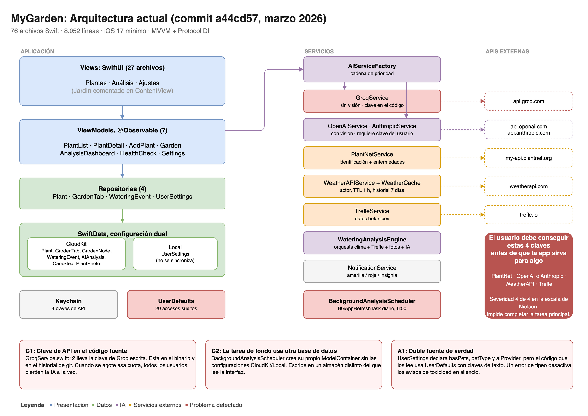
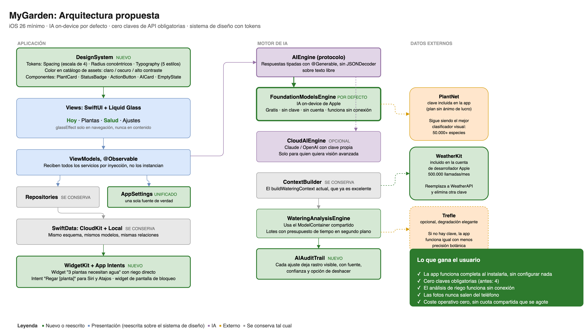
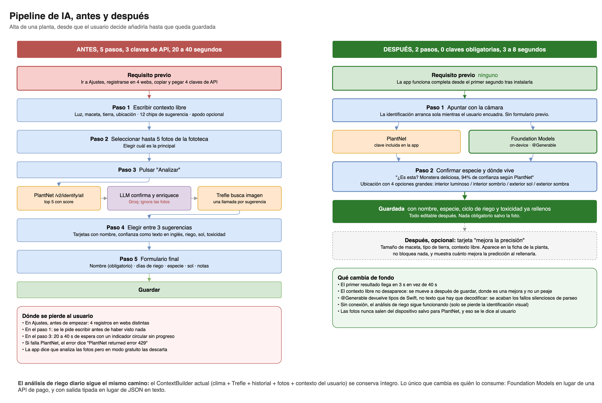
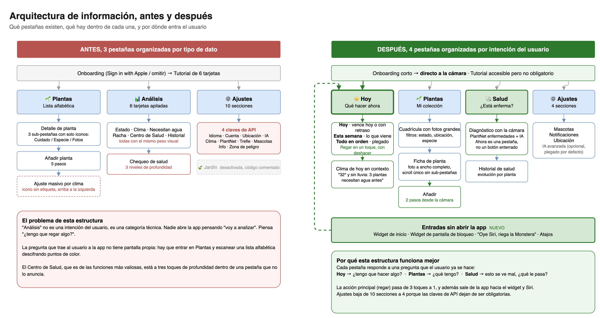

# MyGarden: Reporte de Estado y Propuesta de Rediseño

**Fecha:** 11 de septiembre de 2026
**Versión analizada:** commit `a44cd57` (20 de marzo de 2026) + 19 archivos con cambios sin commitear
**Autor del análisis:** Claude Opus 5

---

## 1. Resumen ejecutivo

MyGarden es una app iOS nativa de cuidado de plantas con identificación por IA, análisis de riego adaptativo y detección de enfermedades. Está **funcionalmente completa** (11 fases implementadas, 76 archivos Swift, ~8.000 líneas) y **técnicamente bien estructurada** (MVVM + inyección de dependencias por protocolo, SwiftData con CloudKit, concurrencia Swift 6). El trabajo de ingeniería que hay debajo es sólido y reutilizable.

El problema no es que la app esté mal hecha. El problema es que **está construida como una herramienta y no como un producto**:

| Dimensión | Estado | Diagnóstico |
|-----------|--------|-------------|
| Arquitectura de código | Buena | MVVM limpio, servicios desacoplados, repositorios. Se conserva. |
| Modelo de datos | Bueno | SwiftData bien modelado, relaciones con cascade correctas. Se conserva. |
| Pipeline de IA | Funcional pero frágil | Depende de 4 APIs externas con claves que pone el usuario. Punto único de abandono. |
| Diseño visual | Genérico | SwiftUI por defecto, sin sistema de diseño, sin identidad. |
| Experiencia de usuario | Deficiente | Barrera de entrada altísima, jerarquía invertida, sin feedback. |
| Accesibilidad | Ausente | 0 etiquetas de accesibilidad, estado codificado solo por color. |
| Plataforma | Desactualizada | iOS 17 como mínimo. iOS 26 ya trajo Liquid Glass, iOS 27 sale el 14 de septiembre de 2026. |

**Tesis central del rediseño:** la app le pide al usuario que trabaje para ella (consigue 4 API keys, rellena 5 pasos, interpreta JSON de IA) cuando debería ser al revés. El rediseño no consiste en repintar pantallas, sino en **invertir quién hace el esfuerzo**.

Las tres decisiones de mayor impacto, en orden:

1. **Eliminar las API keys del camino del usuario.** Usar Foundation Models (IA on-device de Apple, gratis, sin clave, disponible desde iOS 26) como motor por defecto. La app debe funcionar completa el primer minuto tras instalarla.
2. **Cambiar el modelo mental de "biblioteca de plantas" a "qué hago hoy".** La pantalla principal actual es una lista alfabética de inventario. Debería ser una lista de tareas del día.
3. **Adoptar el sistema de diseño de iOS 26/27 (Liquid Glass) y construir un sistema de tokens propio.** Hoy no existe ningún sistema de diseño: los colores están hardcodeados en hexadecimal y los espaciados son números mágicos repartidos por 30 archivos.

---

---

## 1bis. Errata: corrección al motor de IA (11 de septiembre de 2026)

> Esta sección corrige un error de la propuesta P1. Se detectó al verificar las fuentes
> primarias de la WWDC26 contra la documentación de Apple. **La P1 original era incorrecta
> en un punto que invalidaba su propia promesa.**

### El error

La P1 recomendaba Foundation Models como motor por defecto con el argumento de que "la app
funciona completa al instalarla, sin configurar nada". No se comprobó el suelo de dispositivo.

**Foundation Models requiere Apple Intelligence, que requiere A17 Pro o superior**, es decir
iPhone 15 Pro en adelante. El iPhone 15 y el 15 Plus no lo tienen. El objetivo mínimo del
proyecto es iOS 26, que instala desde el **iPhone 11**.

Entre el iPhone 11 y el iPhone 15 Plus hay un tramo grande de dispositivos donde la app se
instala, arranca, y `SystemLanguageModel` no está disponible. Private Cloud Compute tampoco
es salida, porque también exige un dispositivo con Apple Intelligence.

En esos dispositivos, con la P1 original, se caían el ajuste de riego diario, el chat anclado
y la explicación del diagnóstico. Es decir, se caía exactamente la razón de ser del rediseño.

Esto es especialmente grave porque los bloqueantes de pre-producción del proyecto viejo
incluían "Performance optimization (thumbnails, compression para iPhone 11)", lo que indica
que el iPhone 11 es un dispositivo real de prueba para el usuario.

### La corrección: el motor determinista es el suelo, no el plan de contingencia

El `system prompt` actual de la app le dicta al LLM reglas que **ya son deterministas**:

```
Si llovio los ultimos dias -> la planta necesita menos riego
Si hubo ola de calor con UV alto -> puede necesitar mas riego
Macetas pequenas (<15cm) se secan mas rapido
Terracota evapora mas que plastico
```

Eso no es razonamiento, es un balance hídrico escrito en prosa. Se estaba usando un modelo
de lenguaje para interpretar reglas que se pueden calcular.

**El enrutado pasa de dos niveles a tres:**

| Nivel | Motor | Disponibilidad | Qué aporta |
|-------|-------|----------------|------------|
| 1 | `WateringRuleEngine` determinista | **Cualquier iPhone con iOS 26** | Produce **siempre** el número: el ciclo de riego |
| 2 | Foundation Models on-device | iPhone 15 Pro en adelante | La explicación en lenguaje humano, más una corrección acotada a más menos 2 días solo con confianza alta y motivo declarado |
| 3 | PCC o clave del usuario | iPhone 15 Pro en adelante, o cualquiera con clave propia | Chat anclado y narrativa del diagnóstico |

**Las reglas mandan siempre.** Si el LLM pudiera mover el número libremente, la misma planta
con el mismo clima recibiría un calendario distinto en un iPhone 11 y en un iPhone 17: el
consejo de riego dependería del hardware, lo cual es indefendible. El modelo es **aditivo**,
no determinante.

La auditoría separa ambas cosas: "reglas: cada 5 días. La IA lo bajó a 4 porque ve la tierra
todavía húmeda en tu última foto".

### Cómo se construye el motor de reglas

Como un balance de agua, no como una cadena de condicionales:

- **Reserva:** volumen de sustrato, en función del diámetro y profundidad de la maceta y del tipo de tierra
- **Salida:** evapotranspiración. Con los datos de WeatherKit basta la ecuación de Hargreaves, que solo necesita temperatura máxima, mínima y radiación extraterrestre (calculable con latitud y día del año)
- **Coeficiente de planta:** el **grupo funcional** definido para la P12 (suculenta, tropical de interior, aromática, arbusto de exterior) es exactamente este parámetro. La decisión tomada para las plantas no reconocidas aporta gratis lo que necesita el motor. Para las plantas identificadas, la tolerancia a sequía y la humedad de sustrato objetivo de Trefle lo afinan
- **Entradas:** riegos registrados y lluvia
- **Modificadores de exposición:** material de la maceta, interior u exterior, sol directo o indirecto

Ventaja añadida: las reglas son **testeables con asserts**. Un LLM no. Aquí está la mayor
parte del 80% de cobertura que exige la guía del usuario.

### Degradación de las funciones que no tienen suelo determinista

El chat (M04) y la narrativa del diagnóstico (M09) no se pueden calcular. Pero **no se ocultan
ni dan error: se degradan**, porque ocultar funciones sin explicar es el mismo patrón que
critica el hallazgo A2.

- **M04 Chat:** el panel de 6 fuentes es contenido **estático**. PlantNet, Trefle, WeatherKit, el historial, las fotos y el texto del usuario existen en cualquier iPhone. Sin modelo, el botón "Preguntar" abre ese panel como ficha de datos consultable, con una nota honesta y la opción de usar clave propia. Se pierde la conversación, no la información
- **M09 Salud:** PlantNet detecta enfermedades desde su API y funciona en cualquier dispositivo. Sin modelo se muestra "PlantNet detectó mildiu con 78% de confianza" más recomendaciones plantilladas por patología
- **M03 Ficha:** la tarjeta de IA necesita variante determinista. La plantilla se escribe primero y el LLM la reescribe cuando está disponible, no al revés
- **M10 Ajustes:** la fila del estado de la IA necesita **tres** variantes, porque `SystemLanguageModel.availability` distingue casos que exigen mensajes distintos. Dispositivo no elegible: no mandar al usuario a activar algo que su teléfono no tiene, ofrecerle la clave propia. Apple Intelligence desactivada: explicar cómo activarla. Modelo descargándose: estado temporal

### Otras correcciones de la misma verificación

- Los niveles de razonamiento de PCC son **tres** (`.light`, `.moderate`, `.deep`), no dos
- El tramo gratuito de PCC **sí es de Apple**, no de prensa secundaria como advertía la P1. Pero tiene dos condiciones que la P1 no recogía: **hay que solicitarlo** en la web de desarrollador (no es automático por pertenecer al Small Business Program) y tiene **límite diario por usuario**, mayor si el usuario tiene iCloud+
- El protocolo `LanguageModel` existe de verdad, con paquetes de Swift de Anthropic y Google que conforman a él
- Las APIs para inspeccionar contexto y contar tokens llegaron en iOS 26.4

---

## 2. Nota previa: dónde estaba el proyecto

Al empezar el análisis, `~/proyectos/myGarden` contenía **únicamente** `myGarden.xcodeproj` sin código fuente, sin `.git` y sin tests. El proyecto real y completo estaba en iCloud Drive, en `~/Library/Mobile Documents/com~apple~CloudDocs/Documents/CODE/myGarden/`.

Reconstrucción de lo ocurrido, según las huellas del sistema de archivos:

1. En algún momento estuvo activado **"Escritorio y Documentos" en iCloud** (dentro de iCloud Drive existen carpetas `Desktop/` y `Documents/` completas).
2. Esa sincronización se desactivó después. macOS no devuelve los archivos al disco local cuando se desactiva: los deja en iCloud Drive y crea un `~/Documents` local vacío.
3. El 23 de abril algo copió `myGarden` de vuelta al disco local, pero solo llegó el `.xcodeproj`. La explicación más probable (no confirmada) es que el resto de archivos estuvieran sin descargar en ese momento, de modo que la copia solo arrastró lo materializado en disco.

**No se perdió nada.** El proyecto completo, el historial de git (12 commits) y los 19 archivos con cambios sin commitear se copiaron a `~/proyectos/myGarden/` y se verificaron.

> **Recomendación operativa:** no trabajes proyectos de Xcode dentro de iCloud Drive. La sincronización a medias durante una compilación corrompe `DerivedData` y puede dejar el índice de git en estados inconsistentes. Usa GitHub como respaldo, no iCloud.

---

## 3. Inventario del código

```
76 archivos Swift, 8.052 líneas (sin contar tests)

Core/            8 archivos    AppState, AppLanguage, DependencyContainer,
                               OrientationManager, Keychain, extensiones
Models/          8 archivos    Plant, GardenTab, GardenNode, WateringEvent,
                               AIAnalysis, CareStep, PlantPhoto, UserSettings
Repositories/    4 archivos    Plant, GardenTab, WateringEvent, UserSettings
Services/       18 archivos    AI (5 proveedores + factory + prompts),
                               PlantNet, Trefle, Weather + caché, Auth,
                               Watering, Notifications
ViewModels/      7 archivos    PlantList, PlantDetail, AddPlant, Garden,
                               AnalysisDashboard, HealthCheck, Settings
Views/          27 archivos    App (4), Garden (6), Plants (6), Analysis (3),
                               Settings (1), Shared (3)
Tests/           4 archivos    737 líneas, sin commitear
```

**Archivos más grandes** (indicador de dónde se acumuló complejidad):

| Archivo | Líneas | Observación |
|---------|--------|-------------|
| `TrefleSpeciesInfoView.swift` | 611 | Una sola vista con toda la ficha botánica. Debería dividirse. |
| `AddPlantFlowView.swift` | 485 | Los 5 pasos del alta en un solo archivo con un `switch` sobre un `Int`. |
| `PlantDetailView.swift` | 360 | Tres pestañas más seis tarjetas en un archivo. |
| `HealthCheckSheet.swift` | 356 | |
| `TrefleService.swift` | 340 | |

Ninguno supera el límite de 800 líneas que define tu guía de estilo, pero los tres primeros están en la zona donde conviene extraer subvistas.

---

## 4. Arquitectura actual

### 4.1 Capas

```
SwiftUI Views  →  @Observable ViewModels  →  Repositories  →  SwiftData
                            ↓
                        Services (red)
                            ↓
            PlantNet · Groq/OpenAI/Anthropic · WeatherAPI · Trefle
```

La inyección de dependencias funciona mediante `DependencyContainer` expuesto como `EnvironmentKey`, con un `MockKeychainService` para previews. Es un patrón correcto.

**Pero el contenedor solo inyecta tres cosas**: `keychainService`, `appState` y `orientationManager`. Todos los demás servicios se instancian **directamente dentro de los ViewModels y de la propia engine**, leyendo la clave del Keychain en el sitio:

```swift
// AddPlantViewModel.swift
let keychain = KeychainService()
if let pnKey = try? keychain.read(key: KeychainKey.plantNetAPIKey), !pnKey.isEmpty {
    let plantNet = PlantNetService(apiKey: pnKey)
```

Esto significa que la inyección de dependencias existe en la forma pero no en el fondo: no se puede testear `AddPlantViewModel` sin tocar el Keychain real ni la red real.

### 4.2 Persistencia

Configuración dual de `ModelContainer`, correcta conceptualmente:

- **CloudKit**: `Plant`, `GardenTab`, `GardenNode`, `WateringEvent`, `AIAnalysis`, `CareStep`, `PlantPhoto`
- **Local**: `UserSettings` (no se sincroniza, porque es configuración del dispositivo)

Las claves de API viven en Keychain, nunca en SwiftData. Correcto.

### 4.3 Los tres pipelines de IA

**Identificación de especie** (al añadir una planta):

```
Fotos (1 a 5)
  → PlantNet /v2/identify/all      (top 5 resultados con score 0 a 1)
  → LLM confirma y enriquece       (riego, sol, toxicidad, notas de cuidado)
  → Trefle busca imagen de referencia por nombre científico
  → El usuario elige entre 3 sugerencias
```

**Ajuste de riego** (manual, masivo, o diario en segundo plano):

```
Planta + clima (3 días de historial, actual, 3 de pronóstico)
  + datos botánicos de Trefle + último chequeo de salud + contexto libre del usuario
  + últimas 3 fotos (solo si el proveedor soporta visión)
  → LLM → adjust_days entre -3 y +5 → nuevo ciclo de riego
```

**Chequeo de salud** (manual desde el Centro de Salud):

```
Foto
  → PlantNet /v2/diseases/identify  (códigos EPPO con score)
  + contexto de la planta + clima + Trefle
  → LLM (con visión si es premium) → score de salud 1 a 10 + diagnóstico + recomendaciones
```

El diseño de estos pipelines es **la mejor parte de la app**. La idea de usar un clasificador botánico especializado (PlantNet) para la parte visual y un LLM para el razonamiento contextual es correcta y sigue siendo la arquitectura adecuada en 2026. La construcción del contexto en `Prompts.buildWateringContext` es meticulosa: serializa un JSON con datos de la planta, clima, umbrales botánicos de Trefle, seguridad para mascotas e historial.

El problema no es el diseño de los pipelines, es **de qué dependen para arrancar**.

---

## 5. Auditoría técnica

Severidad: **C** crítico, **A** alto, **M** medio, **B** bajo.

### C1. Clave de API de Groq hardcodeada en el código fuente

`Services/AI/GroqService.swift:12`

```swift
static let betaKey = "<llave de Groq retirada>"
```

Una clave en el binario de una app distribuida es una clave pública: cualquiera puede extraerla con `strings` sobre el IPA. Además de la exposición, es un problema de disponibilidad: cuando esa cuenta agote su cuota, **todos** los usuarios pierden la IA a la vez, porque es la única ruta gratuita.

Esta clave debe rotarse aunque la app nunca se publique, porque ya está escrita en el historial de git.

### C2. El `BGAppRefreshTask` crea su propio `ModelContainer`

`Services/Watering/BackgroundAnalysisScheduler.swift`

```swift
let container = try ModelContainer(
    for: Plant.self, GardenTab.self, /* ... */ UserSettings.self
)
```

Construye un contenedor **por defecto**, sin las dos `ModelConfiguration` que usa la app (`CloudKit` y `Local`). No es el mismo almacén. En el mejor caso, el análisis diario escribe en una base de datos distinta de la que lee la interfaz y los resultados nunca aparecen; en el peor, SwiftData crea un tercer almacén en disco.

Además, el bucle recorre **todas** las plantas haciendo una llamada de red por cada una, en secuencia, dentro de un `BGAppRefreshTask` cuyo presupuesto real de ejecución ronda los 30 segundos. Con 10 plantas, la tarea se queda sin tiempo y `expirationHandler` la cancela a mitad.

### A1. Doble fuente de verdad en la configuración

El modelo `UserSettings` de SwiftData declara `hasPets`, `petType`, `aiProvider`, `latitude`, `longitude`, `cityName`, `dailyAnalysisHour`. Pero el código que **de verdad** lee esos valores usa `UserDefaults`:

```swift
// WateringAnalysisEngine.swift
let hasPets = UserDefaults.standard.bool(forKey: "hasPets")
let petType = UserDefaults.standard.string(forKey: "petType")

// AIServiceFactory.swift
let provider = UserDefaults.standard.string(forKey: "aiProvider") ?? "openai"
```

Hay 20 accesos directos a `UserDefaults.standard` repartidos por ViewModels, servicios y vistas. El modelo `UserSettings` existe pero nadie lo consulta en el camino crítico. Dado que la seguridad para mascotas es un requisito explícito del producto, que dependa de una clave de string sin tipar es un riesgo real: un error de tipeo en `"hasPets"` desactiva silenciosamente los avisos de toxicidad.

### A2. El modo gratuito ignora las fotos sin decírselo al usuario

`GroqService.analyzeWateringWithVision` recibe las fotos y las descarta:

```swift
func analyzeWateringWithVision(plantContext: String, systemPrompt: String, photos: [Data]) async throws -> WateringAnalysisResponse {
    print("[Groq] Vision not supported, using text-only analysis (\(photos.count) photos ignored)")
    return try await analyzeWatering(plantContext: plantContext, systemPrompt: systemPrompt)
}
```

Mientras tanto, la interfaz muestra "Analizando" con las fotos en pantalla y el motor imprime `"[Analysis] Sending 3 photos for vision analysis"`. El usuario cree que la IA está mirando su planta. No la está mirando. Esto es, además de un fallo técnico, un problema de confianza: es exactamente el patrón que la literatura de UX de IA identifica como generador de confianza mal calibrada.

### A3. La racha se rompe de forma desproporcionada

`AnalysisDashboardView.calculateStreak()`

```swift
let overdueCount = plants.filter { $0.wateringStatus == .overdue }.count
if overdueCount > 0 { return 0 }
```

Una sola planta en rojo borra la racha completa, aunque las otras quince estén perfectas y el usuario lleve 60 días cuidándolas. Además, la racha cuenta "algún riego ese día", lo que premia tener muchas plantas y castiga tener pocas: con dos plantas de ciclo semanal es matemáticamente imposible mantener una racha de días consecutivos.

La mecánica de racha copiada de Duolingo funciona ahí porque la acción es diaria por diseño. Regar no lo es. La métrica está mal elegida.

### A4. Sin accesibilidad

Cero ocurrencias de `accessibilityLabel`, `accessibilityHint`, `accessibilityValue` o `accessibilityElement` en todo el proyecto.

El caso más grave es `WateringStatusDot`: un `Circle` de 12 puntos relleno de color, sin etiqueta. Para VoiceOver es un elemento invisible. Para una persona con daltonismo rojo-verde (aproximadamente el 8% de los hombres), verde y rojo son el mismo punto gris. **El estado de riego, que es la información central de toda la app, se transmite exclusivamente por color.** Esto incumple el criterio WCAG 1.4.1 (uso del color).

### M1. Tamaños de toque por debajo del mínimo

Los chips de sugerencia en el paso 1 del alta usan `.font(.caption)` con `padding(.vertical, 6)`, lo que resulta en unos 28 puntos de alto. El mínimo de la HIG es 44x44. Lo mismo ocurre con el punto de estado (12 a 14 puntos), aunque ese no sea interactivo hoy.

### M2. 59 `print()` en lugar de logging estructurado

Incluidos varios que vuelcan fragmentos de respuestas de API. En producción, `print` va al log del sistema sin niveles, sin categorías y sin posibilidad de filtrado o redacción. `os.Logger` con `privacy: .private` es el reemplazo directo.

### M3. Errores tragados en silencio

10 apariciones de `try? context.save()`. Si SwiftData falla al guardar un riego, el usuario ve el gesto completarse y el dato se pierde sin ningún aviso. Esto contradice directamente tu propia guía (`common/coding-style.md`: "Never silently swallow errors").

### M4. Cálculo de miniaturas en cada renderizado

`PlantImageView` llama a `CGImageSourceCreateThumbnailAtIndex` dentro de `body`. SwiftUI reconstruye `body` muchas veces: al hacer scroll por una lista de 30 plantas, esa decodificación se repite continuamente. El uso de ImageIO en lugar de `UIImage(data:)` es la decisión correcta, pero falta una caché (`NSCache` o `@State` con `.task(id:)`).

### M5. Rama muerta en el alta de plantas

`AddPlantViewModel.hasAIKey` devuelve `true` siempre (comentario: "Groq always available"). Por tanto, el bloque `else` de `aiOrManualStep` que muestra "configura la IA" es código inalcanzable. Ocurre lo mismo con `PlantDetailView`, donde el botón de analizar está condicionado a esa misma constante.

### B1. Divergencia entre documentación y realidad

`CLAUDE.md` afirma "68 Swift files, ~74K lines" (son 76 archivos y 8.052 líneas), Swift 6.2 (el proyecto declara `SWIFT_VERSION = 6.0`) y "4 tabs" (hay 3, porque la de Jardín está comentada).

### B2. Los tests no están en git

`ModelDecodingTests.swift`, `PromptTests.swift` y `UtilityTests.swift` (737 líneas) aparecen como `??` en `git status`. Nunca se han commiteado, así que no existen para nadie más ni para CI.

---

## 6. Auditoría de UX: las 10 heurísticas de Nielsen

Evaluación con la escala de severidad de NN/g: 0 cosmético, 4 catástrofe.

### H1. Visibilidad del estado del sistema: Severidad 3

Durante el análisis de IA, que puede tardar entre 5 y 20 segundos encadenando PlantNet, LLM y Trefle, la interfaz muestra un `ProgressView` circular y un texto de paso. Es mejor que nada, pero el usuario no sabe cuánto falta ni qué se está haciendo realmente. En el análisis masivo por clima, un `ProgressView` en la barra de navegación cubre N llamadas de red secuenciales sin indicar cuál va ni cuántas quedan.

El caso más serio: **el ajuste automático diario en segundo plano no deja ningún rastro visible**. El ciclo de riego de una planta puede cambiar de 7 a 10 días mientras el usuario duerme y no hay ninguna notificación, insignia ni marca de "esto cambió" cuando abre la app.

### H2. Correspondencia con el mundo real: Severidad 2

El vocabulario de la interfaz está tomado del modelo de datos, no del jardinero:

| La app dice | El usuario piensa |
|-------------|-------------------|
| "Ajuste: +3 días" | "¿Riego hoy o no?" |
| "Ciclo efectivo: 8 días" | "Cada cuánto la riego" |
| "confidence: medium" | "¿Me fío de esto?" |
| "Análisis" (nombre de pestaña) | No corresponde a ninguna intención del usuario |

`adjust_days`, `effectiveCycleDays` y `confidence` son nombres de campos JSON que se filtraron a la superficie.

### H3. Control y libertad del usuario: Severidad 3

**No existe deshacer en ninguna parte.** Regar por deslizamiento en la lista es un gesto de un toque, sin confirmación y sin vuelta atrás: si te equivocas de fila, has registrado un riego falso que desplaza el calendario y cancela las notificaciones de esa planta. El detalle de la planta sí tiene doble toque de confirmación para regar, pero la lista, que es donde la gente riega de verdad, no.

Borrar una planta desde la barra de herramientas del detalle es inmediato, destructivo y sin confirmación:

```swift
Button(role: .destructive) {
    modelContext.delete(plant)
    try? modelContext.save()
    dismiss()
}
```

Se pierden fotos, historial de riego y análisis con un solo toque. Irónicamente, la función de borrado masivo ("Zona de peligro") sí tiene doble confirmación. La protección está donde menos se necesita.

### H4. Consistencia y estándares: Severidad 2

- Los botones de navegación del alta están a veces arriba (barra) y a veces abajo (dentro del contenido).
- El paso 5 usa un `Form`, los pasos 1 a 4 usan `VStack` y `ScrollView` sueltos. El cambio de aspecto es brusco.
- Los colores se mezclan: `.purple` para IA, `.blue` para agua, `.orange` para clima y racha, `.green` para plantas, más los cuatro colores de estado hexadecimales. No hay una paleta, hay una acumulación.
- El detalle de planta usa un `Picker` segmentado con solo iconos y sin texto, dentro de un `TabView` paginado: dos mecanismos de navegación superpuestos sobre el mismo contenido.

### H5. Prevención de errores: Severidad 3

El flujo de alta deja llegar hasta el paso 5 con datos insuficientes y solo ahí bloquea el botón de guardar (`canSave` exige nombre y al menos una foto). No hay validación progresiva. El campo de ciudad manual solo se guarda con `onSubmit`: si el usuario escribe la ciudad y toca fuera del campo, el texto se pierde sin aviso.

### H6. Reconocimiento antes que recuerdo: Severidad 4

Esta es la violación más grave de la app. **Para usar MyGarden hay que recordar (o ir a buscar) cuatro claves de API de cuatro servicios distintos:**

- `my.plantnet.org` para identificación
- OpenAI o Anthropic para visión
- `weatherapi.com` para clima
- `trefle.io` para datos botánicos

Cada una exige registrarse en un sitio web, encontrar dónde se generan las claves, copiarlas y pegarlas en un `SecureField` de Ajustes. La app no explica qué se pierde si no las pones, no verifica si funcionan (salvo la de IA, con un botón "Probar"), y no ofrece ninguna alternativa.

En términos de NN/g esto es una **catástrofe de usabilidad**: impide completar la tarea principal. En términos de producto, es la razón por la que una app así no puede publicarse en la App Store: el 99% de los usuarios abandonaría en Ajustes.

### H7. Flexibilidad y eficiencia: Severidad 2

No hay atajos de ningún tipo: sin widgets de pantalla de inicio, sin Live Activities, sin App Intents ni Shortcuts, sin acciones rápidas del icono, sin Control Center. Regar una planta requiere abrir la app, encontrarla y deslizar. La acción más frecuente del producto, que ocurre varias veces por semana, no tiene ningún camino corto.

Existe el análisis masivo por clima, que es un buen acelerador, pero está escondido detrás de un icono `cloud.sun` sin etiqueta en la esquina superior izquierda.

### H8. Diseño estético y minimalista: Severidad 3

La pestaña de Análisis apila seis tarjetas de igual peso visual en un scroll vertical: estado, clima, plantas que necesitan agua, racha, centro de salud e historial. Todo compite, nada destaca. El detalle de planta muestra `plant_profile`, `environmental_factors`, `risk_assessment`, `reasoning` y `watering_tip`: cinco campos de texto generado por IA, todos a la vez, sin jerarquía.

La respuesta del modelo se vuelca en pantalla tal cual llega. No hay una decisión editorial sobre qué merece ser leído.

### H9. Recuperación de errores: Severidad 3

Los errores se muestran como `error.localizedDescription` en texto rojo:

```swift
Text(error).font(.caption).foregroundStyle(.red)
```

Eso produce mensajes como "PlantNet returned error 429" o "The operation couldn't be completed". No dicen qué pasó en lenguaje humano, por qué, ni qué hacer. `PlantNetError.rateLimited` sí tiene un texto decente ("límite diario alcanzado"), pero no ofrece ninguna acción de recuperación.

No hay reintentos, ni respaldo offline, ni detección de falta de conexión.

### H10. Ayuda y documentación: Severidad 1

El tutorial de 6 tarjetas es lo mejor resuelto del apartado de onboarding, y es reaccesible desde Ajustes. Bien. Lo que falta es ayuda **contextual**: no hay nada que explique, en el momento en que importa, qué es Trefle o por qué la app quiere tu ubicación.

### Resumen de severidad

| Heurística | Severidad | Titular |
|------------|-----------|---------|
| H6 Reconocimiento vs recuerdo | **4** | Cuatro claves de API bloquean el uso |
| H1 Visibilidad del estado | 3 | Cambios de IA invisibles |
| H3 Control y libertad | 3 | Sin deshacer, borrado sin confirmar |
| H5 Prevención de errores | 3 | Validación tardía, datos que se pierden |
| H8 Minimalismo | 3 | Todo pesa igual, IA volcada en crudo |
| H9 Recuperación de errores | 3 | Mensajes técnicos sin salida |
| H2 Lenguaje real | 2 | Vocabulario de base de datos |
| H4 Consistencia | 2 | Navegación y color sin sistema |
| H7 Eficiencia | 2 | Sin widgets ni atajos |
| H10 Ayuda | 1 | Tutorial correcto, falta contexto |

---

## 7. Auditoría visual: MyGarden frente a las guías de Apple (iOS 26 y 27)

### 7.1 Contexto de plataforma

En septiembre de 2025 Apple presentó **Liquid Glass** con iOS 26, el cambio visual más profundo desde iOS 7 en 2013: materiales translúcidos que refractan la luz, reflejos especulares que responden al movimiento del dispositivo, sombras adaptativas y geometría concéntrica. **iOS 27 se publica el 14 de septiembre de 2026**, tres días después de la fecha de este reporte, y con él desaparece la opción de mantener el aspecto anterior: la adopción deja de ser opcional.

MyGarden está compilada contra **iOS 17 como mínimo**. Al recompilar con Xcode 26 o superior, las barras de navegación y de pestañas adoptan el aspecto de cristal automáticamente, pero todo lo que la app dibuja por su cuenta (que es la mayor parte de la interfaz) se queda en el lenguaje visual de 2023.

### 7.2 Comparación punto por punto

| Regla de la HIG | MyGarden hoy | Veredicto |
|-----------------|--------------|-----------|
| El cristal va en la capa de navegación, nunca en el contenido | Usa `.regularMaterial` como fondo de **tarjetas de contenido** en al menos 8 sitios | Invertido |
| Nunca apilar cristal sobre cristal | `AddPlantFlowView`: chips con `.regularMaterial` dentro de tarjetas con `.regularMaterial` | Incumple |
| Varios elementos de cristal van dentro de un `GlassEffectContainer` | No se usa (no existe en iOS 17) | No disponible |
| Objetivos táctiles de 44x44 puntos mínimo | Chips de ~28 puntos de alto | Incumple |
| El color comunica significado, no decoración | 6 colores de acento sin sistema semántico | Incumple |
| Barra de pestañas flotante con 2 a 5 destinos | 3 pestañas, correcto | Cumple |
| Geometría concéntrica en radios anidados | Radios fijos de 8, 12 y 16 sin relación entre sí | Incumple |
| Tipografía con estilos dinámicos del sistema | Usa `.headline`, `.caption`, etc. Correcto | Cumple |
| Soporte de Dynamic Type hasta tamaños de accesibilidad | Sin probar, varios `frame` fijos lo romperán | Riesgo |
| Iconos de app en capas con Icon Composer | Icono plano tradicional | Pendiente |
| Respetar Reducir transparencia y Reducir movimiento | No se consulta ninguna | Incumple |

### 7.3 Ausencia de sistema de diseño

Los colores de estado están escritos como literales hexadecimales:

```swift
static let gardenGreen = Color(hex: "22c55e")   // verde de Tailwind
static let gardenYellow = Color(hex: "eab308")
static let gardenRed = Color(hex: "ef4444")
```

Tres consecuencias:

1. **No se adaptan al modo oscuro.** Un `Color(hex:)` produce un color fijo en sRGB. En modo oscuro, ese verde de Tailwind sobre fondo negro queda con un contraste distinto del previsto, y el amarillo `eab308` sobre fondo claro tiene un ratio de contraste de aproximadamente 1,9:1 con texto blanco, muy por debajo del 4,5:1 que exige WCAG AA.
2. **No respetan Aumentar contraste**, porque no pasan por el catálogo de assets ni por los colores semánticos del sistema.
3. **Son colores de un framework web.** La paleta de Tailwind está diseñada para pantallas de escritorio y navegadores, no para la gama de color P3 de un iPhone ni para el material translúcido de iOS 26.

Con los espaciados ocurre lo mismo: `padding(.horizontal, 24)`, `padding(.horizontal, 40)`, `padding(.horizontal, 32)`, `spacing: 16`, `spacing: 12`, `spacing: 8`, `minHeight: 44`, `size: 60`, `size: 80`, `size: 120`, `size: 200` aparecen como números literales repartidos por las vistas. No hay escala. Cambiar el ritmo visual de la app hoy significa editar 27 archivos a mano.

---

## 8. Qué hace bonita a una app de iPhone

Los fundamentos que sostienen el rediseño propuesto, ordenados por impacto real sobre la percepción de calidad.

### 8.1 La jerarquía es el 80% de la belleza percibida

Una app se ve bien cuando **algo domina**. Si todos los elementos tienen el mismo tamaño, el mismo peso y el mismo fondo, el resultado se lee como desordenado aunque los colores sean bonitos. La regla práctica: en cada pantalla debe haber un elemento claramente primario, dos o tres secundarios, y el resto terciario.

En la pestaña de Análisis actual, las seis tarjetas usan `.regularMaterial`, radio 12 y el mismo padding. No hay primario. Ese es el motivo por el que la pantalla se percibe como un formulario y no como un panel.

### 8.2 Escala tipográfica, no tamaños sueltos

iOS ofrece once estilos de texto (`largeTitle` a `caption2`). La calidad visual aparece cuando se usan **pocos** y con contraste marcado entre ellos: un título de 34 puntos junto a un cuerpo de 17 se ve bien; un título de 20 junto a un cuerpo de 17 se ve mal, porque la diferencia es perceptible pero no intencional. La escala de Apple ya está afinada y además da soporte a Dynamic Type gratis.

### 8.3 Espaciado en una escala de 4 puntos

Todos los espacios deben ser múltiplos de 4 (idealmente de 8): 4, 8, 12, 16, 24, 32, 48. El ojo detecta la irregularidad aunque no sepa nombrarla. La app tiene hoy paddings de 24, 32 y 40 conviviendo sin relación.

### 8.4 Radios concéntricos

Cuando un elemento redondeado va dentro de otro, el radio interior debe ser el exterior menos el espacio entre ambos. Una tarjeta de radio 16 con 8 puntos de padding lleva elementos interiores de radio 8. iOS 26 formaliza esto con `.rect(cornerRadius: .containerConcentric)`. Cuando esto no se respeta, el resultado se ve "barato" sin que el observador sepa por qué.

### 8.5 El color como semántica, no como decoración

Una app de calidad usa **un** color de marca más los colores semánticos del sistema (rojo destructivo, azul enlace). MyGarden usa morado para IA, azul para agua, naranja para clima y racha, verde para plantas, más cuatro colores de estado. Siete acentos es una paleta sin jerarquía: cuando todo está acentuado, nada lo está.

Para esta app en concreto, la recomendación es: **verde como color de marca único**, los cuatro colores de estado de riego como sistema semántico cerrado (y siempre acompañados de forma o texto, nunca solo color), y nada más.

### 8.6 El movimiento comunica causalidad

Las transiciones no son adorno: explican de dónde viene lo que aparece. Un `matchedGeometryEffect` entre la miniatura de la lista y la foto grande del detalle le dice al usuario "es la misma planta". La app tiene hoy **3 animaciones en 8.000 líneas**, y ninguna transición entre pantallas.

### 8.7 La respuesta háptica es la mitad de la sensación de calidad

Cero usos de `sensoryFeedback` en el proyecto. Regar una planta, que es el gesto central del producto, no produce ninguna respuesta física. Un `.sensoryFeedback(.success, trigger:)` en ese momento cambia por completo la percepción de solidez, y cuesta una línea.

### 8.8 Los estados vacíos son la primera impresión

La app tiene `EmptyStateView` con `ContentUnavailableView`, que es lo correcto en iOS. Pero un estado vacío bien hecho no solo dice "no hay nada": enseña la acción de mayor valor y da una razón para hacerla.

### 8.9 Contenido primero, cromo después

Las fotos de las plantas del usuario son el contenido emocional de esta app, y hoy aparecen como miniaturas de 60 puntos en una lista y de 80 en el detalle. En Planta o Greg, la foto ocupa el ancho completo. La app está escondiendo su propio material.

### 8.10 Benchmark: qué hace bien la competencia

| App | Lo que hace mejor | Aplicable a MyGarden |
|-----|-------------------|----------------------|
| **Planta** | Línea temporal visual de tareas por planta, y medición de luz con la cámara para calibrar el riego | La línea temporal reemplaza directamente la lista alfabética actual |
| **Greg** | Calibra el riego con datos meteorológicos locales reales y con el comportamiento agregado de usuarios en climas parecidos | MyGarden ya tiene el clima; le falta el bucle de aprendizaje con el feedback del propio usuario |
| **Blossom** | Diagnóstico de plagas y enfermedades rápido, limpio y reactivo | El Centro de Salud existe pero está enterrado en la tercera pestaña |
| **PictureThis** | Identificación en menos de 2 segundos con la cámara en vivo, sin pasos previos | El alta de MyGarden tiene 5 pasos antes de ver un resultado |

El patrón común: **las tres empiezan por la cámara y terminan en una tarea concreta**. MyGarden empieza por un formulario de contexto y termina en un JSON interpretado.

---

## 9. Propuestas de cambio

Ordenadas por relación impacto/esfuerzo. Cada una indica qué cambia y por qué.

### P1. Sustituir la dependencia de claves de API por el stack de IA de Apple

> **Corregida.** Ver la sección 1bis (Errata): esta propuesta no comprobaba el suelo de dispositivo de Apple Intelligence. El enrutado definitivo tiene tres niveles, con un motor determinista como suelo.

**Qué:** adoptar el framework **Foundation Models** de Apple como motor por defecto, con enrutado por tarea entre el modelo on-device y Private Cloud Compute.

**Por qué:** elimina de un golpe el problema de severidad 4 (H6), el riesgo crítico C1 (clave hardcodeada) y el coste operativo.

**Lo que cambió en la WWDC de junio de 2026 (iOS 27, 14 de septiembre de 2026):**

1. El modelo on-device fue reconstruido y **acepta imágenes**. Ya puede mirar las fotos de las plantas, que era la única razón de peso para depender de OpenAI.
2. **Private Cloud Compute se abre a desarrolladores** desde la misma API de Swift: modelo mucho mayor, 32.000 tokens de contexto y razonamiento configurable (`.light`, `.deep`).
3. Apple **absorbe el coste de PCC** para desarrolladores del App Store Small Business Program con menos de 2 millones de descargas acumuladas.
4. El nuevo protocolo `LanguageModel` permite intercambiar modelos de Apple, Claude y Gemini sin tocar el código que los consume. Es, literalmente, la abstracción `AIEngine` que este reporte proponía, pero de primera parte.

**Enrutado por tarea, no cadena de prioridad.** Este es el cambio conceptual: hoy `AIServiceFactory` da prioridad absoluta a la clave del usuario para **todo**, incluido el análisis diario en segundo plano de cada planta. Eso gasta dinero en la tarea que menos lo necesita.

| Tarea | Motor | Razón |
|-------|-------|-------|
| Ajuste de riego diario (todas las plantas, cada día) | On-device | Es inferencia sobre un contexto que la app ya construye. Un modelo mayor no acierta más. Es además el mayor volumen: 10 plantas por 365 días son 3.650 llamadas al año |
| Chat sobre una planta | PCC, con caída a on-device sin red | Conversación multi-turno sobre seis fuentes. Aquí el modelo grande sí se nota |
| Diagnóstico por foto | PlantNet + PCC | PlantNet clasifica la enfermedad (códigos EPPO), el LLM la explica y la cruza con el historial |
| Identificación de especie | **Siempre PlantNet** | Ningún LLM generalista supera a un clasificador entrenado con más de 50.000 especies |

**Qué pasa con OpenAI y Anthropic:** no se elimina la opción, se degrada. Deja de ser el motor por defecto de todo y pasa a ser una preferencia opcional, plegada en Ajustes, que nunca gobierna el trabajo en segundo plano. El código de `OpenAIService` y `AnthropicService` ya está escrito y sirve de respaldo si el modelo de Apple decepciona en producción.

**Salida tipada:** Foundation Models soporta generación guiada con `@Generable`, lo que permite declarar la respuesta como un tipo de Swift y eliminar el `JSONDecoder` sobre texto libre, que hoy es la causa más probable de fallos silenciosos del pipeline.

**Verificación pendiente:** las condiciones exactas del tramo gratuito de PCC (límites, regiones, requisitos de elegibilidad) deben confirmarse en la documentación de Apple antes de apostar la arquitectura a ello. El plan de contingencia es quedarse en on-device puro, que sigue cubriendo el ajuste de riego sin coste.

**Objetivo de sistema:** iOS 26 como mínimo, con mejora progresiva bajo `#available(iOS 27)` para visión on-device y PCC. iOS 27 sale el 14 de septiembre de 2026 y su adopción el primer mes es baja, así que exigirlo cerraría la app a casi todo el parque durante meses.

### P2. Invertir la pantalla principal: de inventario a agenda

**Qué:** la pestaña principal deja de ser una lista alfabética de plantas y pasa a ser **"Hoy"**: qué hay que hacer, ordenado por urgencia.

```
HOY
  [ ] Regar Monstera        vence hoy
  [ ] Regar Potus           2 días de retraso
ESTA SEMANA
      Ficus                 en 3 días
TODO EN ORDEN
      12 plantas más
```

**Por qué:** el usuario no abre la app para consultar su inventario, la abre para saber si tiene que hacer algo. La lista alfabética obliga a escanear 15 filas y decodificar puntos de color para responder a una pregunta que la app ya sabe contestar. La biblioteca completa sigue existiendo, un nivel más adentro.

### P3. Un solo gesto para regar, con deshacer

**Qué:** botón de regar directamente en cada fila (44x44), con respuesta háptica de éxito y un aviso de deshacer de 5 segundos. Eliminar el doble toque de confirmación del detalle, que deja de ser necesario cuando existe deshacer.

**Por qué:** resuelve H3 (severidad 3). La confirmación previa protege contra el error pero añade fricción a la acción más frecuente del producto. El deshacer posterior protege igual sin fricción, que es el patrón correcto según NN/g.

### P4. Hacer visible y auditable lo que hace la IA

**Qué:**

1. Cuando el análisis en segundo plano cambie un ciclo de riego, dejar rastro: una marca en la fila ("la IA ajustó esto ayer") y una línea en el detalle.
2. Mostrar la confianza en lenguaje humano y con acción: en vez de `confidence: medium`, "No estoy seguro, revísalo tú" con un botón para aceptar o descartar el ajuste.
3. **Nunca decir que se analizan fotos si no se analizan.** Si el proveedor activo no tiene visión, el texto debe decirlo y ofrecer la alternativa.
4. Citar de dónde viene cada dato: "PlantNet, 94% de confianza", "Trefle: tolerancia a sequía 7/10", "AEMET: 32 grados y sin lluvia en 5 días".

**Por qué:** la literatura de UX de IA converge en un punto: el objetivo no es la confianza máxima, es la **confianza calibrada**. El usuario debe fiarse cuando el sistema acierta y desconfiar cuando duda. Ocultar la incertidumbre produce lo contrario.

### P5. Rehacer la racha o eliminarla

**Qué:** sustituir la racha de días consecutivos por un indicador de **salud del jardín** (porcentaje de plantas en verde durante los últimos 30 días, con tendencia). O eliminarla.

**Por qué:** regar no es una actividad diaria, así que una racha diaria es una métrica que el usuario no puede ganar de forma legítima. Una mecánica de juego que castiga el comportamiento correcto es peor que no tener mecánica.

### P6. Sistema de diseño con tokens

**Qué:** crear `DesignSystem/` con:

- `Tokens/Spacing.swift`: escala de 4 puntos (`xs` 4, `sm` 8, `md` 16, `lg` 24, `xl` 32, `xxl` 48)
- `Tokens/Radius.swift`: radios concéntricos (`card` 16, `inner` 8, `pill` capsule)
- `Tokens/Typography.swift`: los 5 estilos permitidos, mapeados a los del sistema
- Colores en el catálogo de assets con variantes claro/oscuro y alto contraste, no en hexadecimal
- `Components/`: `PlantCard`, `StatusBadge`, `ActionButton`, `AICard`, `EmptyState`

**Por qué:** resuelve H4 y hace posible cambiar el aspecto de toda la app desde un sitio. Es la condición previa para cualquier rediseño visual serio.

### P7. Estado de riego con forma, texto y color

**Qué:** cada estado se codifica en tres canales a la vez:

| Estado | Color | Forma | Texto |
|--------|-------|-------|-------|
| Al día | Verde | Círculo relleno | "Al día" |
| Pronto | Ámbar | Círculo medio lleno | "En 2 días" |
| Vencido | Rojo | Círculo con exclamación | "2 días de retraso" |
| Sin regar | Gris | Círculo punteado | "Sin registro" |

Más `accessibilityLabel` en todos.

**Por qué:** resuelve A4 y WCAG 1.4.1. Y además mejora la app para todo el mundo: "2 días de retraso" es más informativo que un punto rojo, tenga o no el usuario dificultades de visión.

### P8. Reducir el alta de 5 pasos a 2

**Qué:**

```
Paso 1: Cámara. Se dispara la identificación mientras el usuario mira el resultado.
Paso 2: Confirmar especie y ubicación. Todo lo demás lo rellena la IA, editable después.
```

El bloque de contexto libre (luz, maceta, tierra) se mueve **después** de guardar, como una tarjeta opcional de "mejora la precisión". La idea del contexto libre es buena y aporta mucho al prompt; el problema es que hoy es el **primer** obstáculo, antes incluso de ver una foto.

**Por qué:** PictureThis identifica en 2 segundos desde la cámara. Cinco pasos antes del primer resultado es donde se pierde al usuario.

#### Ampliación del 13 de septiembre: fotos de referencia en la elección de especie

El usuario señaló el problema de fondo de esta pantalla: **un porcentaje de confianza no le
sirve a una persona para decidir si esa es su planta**. "Monstera deliciosa, 94%" solo es
verificable si ya sabes qué es una Monstera. Lo que la persona necesita es **comparar**.

La pantalla de confirmación pasa a estar construida alrededor de la comparación:

- **La foto del usuario queda fijada arriba** (`safeAreaInset`), no se va con el scroll. Comparar exige ver las dos cosas a la vez.
- **Cada candidata trae fotos de referencia** de la especie, en una tira horizontal, etiquetadas por órgano (hoja, porte, flor, tallo). El órgano importa: si el usuario fotografió una hoja, la foto de referencia de la hoja es la que decide.
- **La lista es scrollable y muestra todas las coincidencias**, no solo tres. PlantNet devuelve hasta 10 y no hay razón para esconder las que el usuario podría reconocer.
- **"Ninguna se parece"** al final, que lleva a M07 (planta no reconocida).

**De dónde salen las imágenes:** vienen en la misma respuesta de `/v2/identify`, sin llamada
extra y sin depender de Trefle. **Pero hay que pedirlas**: el parámetro
`include-related-images=true` es obligatorio. Sin él, `images` llega ausente (`nil`) en todos
los resultados, no vacío. Verificado contra la API real el 13 de septiembre de 2026.

**El modelo actual no las decodifica.** `PlantNetResult` en `PlantNetModels.swift` solo tiene
`score`, `species`, `gbif` y `powo`. Hay que añadir `images`, con `organ`, `author`, `license`,
`date`, `citation` y las URLs por tamaño (`url.o`, `url.m`, `url.s`). El campo `citation` ya
viene pre-armado como `Autor / Pl@ntNet, cc-by-sa`, con la licencia en minúscula, así que si se
muestra literal hay que tenerlo en cuenta.

#### Corrección del mismo día: todas las referencias son del mismo órgano

La primera versión de esta pantalla mostraba una tira mezclando órganos (hoja, porte, flor,
tallo). **Eso no ocurre en la realidad.** Las imágenes que devuelve PlantNet son todas del
mismo órgano que su clasificador detectó en la foto que subió el usuario. En una prueba real
con una foto de planta entera, PlantNet la clasificó como `flower` con 0,79 de confianza y
devolvió seis imágenes de flor.

**La realidad resulta ser mejor que el diseño original.** Comparar una foto de hoja contra
seis hojas de referencia es una señal mucho más fuerte que compararla contra una hoja, un
porte y una flor. Se compara lo mismo con lo mismo.

Consecuencias en el diseño:

- El órgano se nombra **una vez** por candidata ("Hojas de esta especie, 5"), no con una insignia sobre cada foto, que sería redundante
- La barra de comparación fija muestra **cómo leyó PlantNet la foto del usuario** ("PlantNet la leyó como hoja"). Esto no es un adorno: si el clasificador se equivoca de órgano, la identificación entera va mal encaminada, y el usuario es quien puede detectarlo
- Aparece un botón **"Otro ángulo"**, que es la forma de recuperar la variedad de órganos: cada foto adicional de un órgano distinto genera su propio conjunto de referencias. Mantiene el camino rápido en dos pasos y deja la profundidad como opción

**Atribución obligatoria.** Las fotos de PlantNet son Creative Commons Attribution-ShareAlike.
Mostrarlas obliga a citar tres cosas: la plataforma, la licencia y el autor. El formato que
recomienda PlantNet es `Photo(s): [usuario] / Pl@ntNet, CC BY-SA`. Esto **no es opcional** y
hay que reservarle sitio en el diseño, igual que la atribución de Apple Weather. Ya está
puesto en la maqueta, debajo de la lista.

Esto se suma a la atribución "Powered by Pl@ntNet" que ya exigía el plan sin ánimo de lucro
por usar la identificación.

### P9. Widgets, App Intents y Live Activities  **[REQUISITO, no opcional]**

**Qué:**

- Widget de pantalla de inicio: "3 plantas necesitan agua" con toque directo para regar
- App Intent "Regar [planta]" para Siri y Atajos
- Widget de pantalla de bloqueo con el conteo de pendientes

**Por qué:** resuelve H7. La acción principal del producto debe ser accesible sin abrir la app. Regar ocurre varias veces por semana y hoy cuesta tres toques **después** de abrir la app, con lo que el producto compite contra la memoria del usuario y pierde. El widget convierte el recordatorio y la acción en la misma cosa.

Con App Intents interactivos (disponibles desde iOS 17), el toque en la gota del widget registra el riego sin abrir la app, y el mismo intent sirve para Siri y Atajos sin escribirlo dos veces. MyGarden ya tiene todo el modelo de datos necesario.

**Marcado como requisito por decisión explícita del usuario (11 de septiembre de 2026).** No entra en la fase de pulido: entra en el alcance mínimo.

### P12. Añadir plantas que la IA no reconoce

**Qué:** cuando ni PlantNet ni el LLM identifican la especie, la app no puede dejar al usuario en un callejón sin salida. En vez de exigir la especie, pregunta por lo que el usuario **sí puede ver** y deduce un perfil de cuidado a partir del **grupo funcional**, no de la especie:

- ¿A qué se parece más? (suculenta o cactus / tropical de interior / aromática o comestible / arbusto de exterior / no sabría decir)
- Un par de rasgos observables: hoja fina, ancha o con espinas; tamaño pequeño, mediano o grande
- Texto libre para lo que sea que el usuario sepa

Con eso la app genera un **perfil provisional** con confianza declarada como baja, y avisa de que va a ser conservadora y a corregir el ciclo con lo que pase de verdad: los riegos reales, las fotos y el clima.

**Por qué:** botánicamente, el grupo funcional predice el riego mucho mejor que el nombre. Una suculenta se riega como suculenta aunque no sepas si es una *Echeveria* o una *Haworthia*. Exigir la especie es pedir un dato que el usuario no tiene para resolver un problema que no lo necesita.

Además guarda un recordatorio para **reintentar la identificación más adelante**: cuando la planta eche hojas nuevas o florezca, una foto nueva suele bastar.

### P13. Siembra desde semilla

**Qué:** un modo de alta distinto para cuando el usuario está sembrando, no adoptando una planta ya crecida. Pide qué semilla, dónde (semillero, maceta o directo a tierra) y cuándo, y genera un **plan por etapas**.

**Por qué, y por qué esto toca el modelo de datos:** una semilla no tiene un ciclo de riego fijo, tiene etapas, y cada etapa quiere un riego distinto:

| Etapa | Riego | Duración típica |
|-------|-------|-----------------|
| Siembra | Sustrato húmedo constante, sin encharcar | Días 0 a 3 |
| Germinación | Pulverización 2 veces al día | Días 4 a 10 |
| Plántula | Cada 2 días, primera luz directa suave | Días 11 a 25 |
| Trasplante | Maceta definitiva, cada 3 días | Día 26 en adelante |

El modelo `Plant` actual solo tiene `waterEveryDays` y `waterEveryDaysAdjusted`, es decir, asume un régimen único e invariable. Para esto hace falta un concepto de **etapa de crecimiento** con su propio plan de riego, y una transición entre etapas que la app pueda detectar (por fecha, o por lo que vea en las fotos del usuario).

También cambia el patrón de notificaciones: durante la germinación el aviso es dos veces al día, no cada varios días. Y si no germina en 14 días, la app debe avisar y ayudar a revisar qué falló, en vez de quedarse esperando en silencio.

### P14. Chat por planta, anclado a las fuentes reales

**Qué:** desde la ficha de cualquier planta, abrir una conversación con la IA. La diferencia con un chatbot genérico es el **anclaje**: la IA no responde desde su conocimiento general, responde sobre **esta** planta, con todo lo que la app ya tiene recopilado sobre ella:

| Fuente | Qué aporta |
|--------|-----------|
| PlantNet | La especie identificada y con qué confianza |
| Trefle | Umbrales botánicos: luz, humedad de sustrato, tolerancia a sequía, toxicidad, temperaturas |
| WeatherKit | Historial de 3 días, hoy y pronóstico de 3, de la ubicación real del usuario |
| Historial de riego | Cuántas veces, cada cuánto, desde cuándo |
| Fotos | La evolución visual de esa planta concreta |
| Contexto del usuario | Maceta, tierra, ubicación, y lo que haya escrito |

**Por qué importa el anclaje:** es la diferencia entre "las Monstera se riegan cada 7 días más o menos" y "la regaste 6 veces en 30 días, con una media de 5 días, y para tu maceta de 18 cm eso es un régimen más húmedo de lo que Trefle marca para esta especie".

**Tres reglas de diseño que hacen que esto funcione:**

1. **El contexto es visible.** Un panel plegable arriba enumera las seis fuentes con lo que aporta cada una. El usuario puede auditar sobre qué está respondiendo.
2. **Cada afirmación cita su fuente.** Chips bajo la respuesta: "Tu historial: 6 riegos / 30 días", "Trefle: humedad 5/10".
3. **Si no está en las fuentes, lo dice.** La regla explícita del prompt es admitir el desconocimiento antes que rellenarlo. Es lo que separa una herramienta útil de un generador de plausibilidad.

**Motor:** PCC cuando hay red, on-device cuando no. Y con el modelo on-device la conversación no sale del teléfono, lo que conviene decirle al usuario en la propia pantalla.

### P10. Arreglos técnicos obligatorios

1. Rotar la clave de Groq y quitarla del código (C1)
2. Pasar el `ModelContainer` compartido a la tarea de segundo plano, y limitar el lote con presupuesto de tiempo (C2)
3. Unificar la configuración en `UserSettings` y eliminar los 20 accesos sueltos a `UserDefaults` (A1)
4. Sustituir los 59 `print` por `os.Logger` con categorías (M2)
5. Propagar los errores de guardado en lugar de `try?` (M3)
6. Cachear las miniaturas (M4)
7. Commitear los tests y llevar la cobertura al 80% que exige tu propia guía (B2)

### P11. Subir el objetivo mínimo a iOS 26

Habilita Liquid Glass nativo, Foundation Models, `@Generable`, los nuevos contenedores de cristal y las APIs modernas de `TabView`. El coste es dejar fuera al iPhone XR y anteriores. Dado que iOS 27 sale en tres días y que la adopción del nuevo lenguaje visual deja de ser opcional, mantenerse en iOS 17 significa construir hoy una app que ya nace vieja.

---

## 10. Roadmap propuesto

| Fase | Contenido | Resultado visible |
|------|-----------|-------------------|
| **0. Saneamiento** | P10 completo, subir a iOS 26, commitear tests | La app compila limpia, sin secretos, sin bugs críticos |
| **1. Sistema de diseño** | P6, P7. Tokens, componentes, colores en assets, accesibilidad | La app se ve consistente, funciona con VoiceOver y en modo oscuro |
| **2. IA sin fricción** | P1, P4. Foundation Models, `@Generable`, trazabilidad | La app funciona completa nada más instalarla, sin claves |
| **3. Nueva estructura** | P2, P3, P8. Pantalla Hoy, regar con deshacer, alta en 2 pasos | El producto cambia de herramienta a asistente |
| **4. Cobertura de casos reales** | P12, P13. Plantas no reconocidas y siembra por etapas | La app deja de fallar en los casos que hoy no cubre |
| **5. Widget y conversación** | P9 (requisito), P14. Widgets, App Intents, chat anclado | Regar sin abrir la app, y preguntar sin adivinar |
| **6. Pulido** | P5. Métrica de salud, hápticas, transiciones | La app se siente de calidad comercial |

---

## 10bis. Diagramas

Los cuatro diagramas están en `docs/diagrams/`, en formato `.drawio` editable y exportados a PNG a 2x.

### Arquitectura actual



Las capas de la app tal como están hoy, con los tres puntos de fallo señalados en rojo: la clave de API en el código fuente, la tarea de fondo escribiendo en otra base de datos, y la doble fuente de verdad entre `UserSettings` y `UserDefaults`. A la derecha, el bloque que resume por qué las cuatro claves de API son un problema de severidad 4.

### Arquitectura propuesta



En verde lo nuevo o reescrito, en gris lo que se conserva tal cual. Los tres cambios estructurales: una capa `DesignSystem` encima de las vistas, el motor de IA detrás de un protocolo con Foundation Models por defecto, y una extensión de widgets que da acceso a la acción principal sin abrir la app.

### Pipeline de IA, antes y después



El alta de una planta, paso a paso, en las dos versiones. A la izquierda los cinco pasos actuales con los puntos donde se pierde al usuario; a la derecha los dos pasos propuestos. El bloque de contexto libre no desaparece: se mueve a después de guardar, donde deja de ser un peaje y pasa a ser una mejora opcional.

### Arquitectura de información



Qué pestañas hay, qué cuelga de cada una, y por dónde entra el usuario. El cambio de fondo es pasar de organizar por tipo de dato ("Análisis") a organizar por intención ("Hoy", "Salud").

---

## 11. Qué se conserva

Para que quede claro que esto no es "tirarlo todo y empezar de cero". Se conserva, tal cual o con retoques menores:

- Toda la capa `Models/` y el esquema de SwiftData
- La configuración dual CloudKit + local
- `Repositories/`
- `PlantNetService` y sus modelos
- `WeatherAPIService` y el `WeatherCache` como actor
- `TrefleService`
- `KeychainService`
- La construcción de contexto de `Prompts.buildWateringContext`, que es excelente
- La arquitectura MVVM y el patrón de contenedor de dependencias
- Las vistas de Jardín, hoy desactivadas, como base para una futura vista espacial

Lo que se reescribe es la **capa de presentación** y el **punto de entrada a la IA**. Aproximadamente el 40% del código, y casi nada de la lógica de negocio.

---

## 12. Fuentes

Guías y referencia técnica:

- [Liquid Glass en SwiftUI: referencia completa de iOS 26](https://github.com/conorluddy/LiquidGlassReference)
- [iOS 26 Design Guidelines con especificaciones ilustradas](https://www.learnui.design/blog/ios-design-guidelines-templates.html)
- [Liquid Glass Design: Best Practices for Apple Apps](https://bitrig.com/blog/liquid-glass-best-practices)
- [Meet the Foundation Models framework (WWDC25)](https://developer.apple.com/videos/play/wwdc2025/286/)
- [Apple Foundation Models: The On-Device LLM Framework, Explained](https://blakecrosley.com/blog/apple-foundation-models-framework)
- [What's new in SwiftUI (WWDC26)](https://developer.apple.com/videos/play/wwdc2026/269/)
- [iOS 27: Everything We Know (MacRumors)](https://www.macrumors.com/roundup/ios-27/)

UX y diseño:

- Nielsen, J. (1994, revisado 2024). *10 Usability Heuristics for User Interface Design*, NN/g
- Norman, D. (2013). *The Design of Everyday Things*, edición revisada
- [10 UX Design Patterns That Improve AI Accuracy and Customer Trust](https://www.cmswire.com/digital-experience/10-ux-design-patterns-that-improve-ai-accuracy-and-customer-trust/)
- [Designing Trust in AI Systems: UX Patterns That Build Confidence](https://medium.com/design-bootcamp/designing-trust-in-ai-systems-ux-patterns-that-build-confidence-70aa9da98c1c)
- [The Trust Calibration Spectrum in UX](https://smart-interface-design-patterns.com/articles/the-trust-calibration-spectrum-in-ux/)

Benchmark competitivo:

- [Best plant care app 2026: Greg, Planta, PlantIn y más](https://botanicallegacy.com/blog/best-plant-care-app-2026)
- [Best Plant Identification Apps 2026: PictureThis, Planta, Greg](https://plantcareclub.com/blog/best-plant-apps-2026)

APIs en uso:

- [Pl@ntNet API, precios y condiciones](https://my.plantnet.org/pricing)
- [Trefle, documentación](https://docs.trefle.io/) (activo a septiembre de 2026, límite de 60 peticiones por minuto)

---

## 13. Pantallas construidas

Las 11 pantallas propuestas están implementadas como **maquetas ejecutables** dentro del proyecto de Xcode. No tocan SwiftData, no llaman a ninguna API y no comparten código con la app real: existen para verse y criticarse antes de escribir la funcionalidad.

### Cómo verlas

1. Abre `myGarden.xcodeproj` en Xcode
2. Compila y ejecuta en el simulador
3. Cuarta pestaña, **Rediseño**
4. Empieza por **"Ver la app entera"**, que es lo más parecido a usar la app rediseñada

También se pueden ver una a una en el canvas de Xcode (`⌥⌘⏎`), porque cada archivo trae previews en claro y oscuro.

### Inventario

| Código | Pantalla | Qué demuestra |
|--------|----------|---------------|
| M01 | Hoy | La pantalla de entrada pasa de inventario a agenda. Regar en un toque con deshacer |
| M02 | Plantas | La biblioteca con la foto como protagonista, filtros por estado |
| M03 | Ficha de planta | Un solo scroll, IA auditable con fuentes y confianza, contexto libre movido al final |
| M04 | **Chat con la planta** | El panel de 6 fuentes que ancla las respuestas. Nuevo |
| M05 | Cámara | Paso 1 de 2, identificación mientras el usuario encuadra |
| M06 | Confirmar | Paso 2 de 2. Lista scrollable de todas las coincidencias, cada una con fotos de referencia etiquetadas por órgano, y la foto del usuario fijada arriba para comparar |
| M07 | **Planta no reconocida** | Perfil de cuidado por grupo funcional, sin exigir la especie. Nuevo |
| M08 | **Sembrar semillas** | Riego por etapas con línea temporal. Nuevo |
| M09 | Salud | El Centro de Salud como pestaña propia, con evolución histórica |
| M10 | Ajustes | De 10 secciones a 4, sin claves obligatorias |
| M11 | **Widgets** | Las tres caras del widget y su comportamiento. Nuevo, y requisito |

### Qué se construyó además de las pantallas

**`DesignSystem/DSTokens.swift`**, La escala de espaciado de 4 puntos, los radios concéntricos, los 6 roles tipográficos y los 11 colores. Incluye `DSWateringState`, que es la corrección del hallazgo A4: cada estado de riego se codifica en **color, forma y texto a la vez**, con etiqueta de accesibilidad.

**`DesignSystem/DSComponents.swift`**, `DSCard`, `DSStatusBadge`, `DSPlantThumb`, `DSPrimaryButton`, `DSSecondaryButton`, `DSSourceChip`, `DSSectionHeader` y `DSConfidenceRow`. El `DSSourceChip` y el `DSConfidenceRow` son los que hacen auditable a la IA.

**`Assets.xcassets/DS/`**, Los 11 colores como colorsets con variantes clara y oscura, que es la corrección del problema de los hexadecimales de Tailwind hardcodeados. Ahora se adaptan al modo oscuro y respetan Aumentar contraste.

### Cómo quitarlo todo

Borrar la carpeta `Mockups/` y el bloque `#if DEBUG` de `ContentView.swift`. `DesignSystem/` y los colorsets están pensados para quedarse: son la base de la implementación real.

---

## 14. Hallazgo adicional: el proyecto no compilaba

Durante esta sesión se detectó que el proyecto **no compilaba**, con este error:

```
error: Multiple commands produce '.../myGarden.app/Info.plist'
```

**Causa:** al abrir el proyecto en Xcode mientras la carpeta de fuentes no estaba presente (el problema de iCloud descrito en la sección 2), Xcode reescribió `project.pbxproj` y eliminó 13 líneas: la sección `PBXFileSystemSynchronizedBuildFileExceptionSet` que excluía `Info.plist` de la copia de recursos. Sin esa excepción, `Info.plist` se procesa dos veces y el build falla.

**Solución aplicada:** se restauraron las 13 líneas directamente sobre el archivo, sin usar comandos destructivos de git. El `project.pbxproj` vuelve a coincidir exactamente con el que está commiteado, y el build pasa.

**Lección:** no abrir un proyecto de Xcode cuyas fuentes no estén completas en disco. Xcode "limpia" referencias que cree rotas y esa limpieza se guarda.
